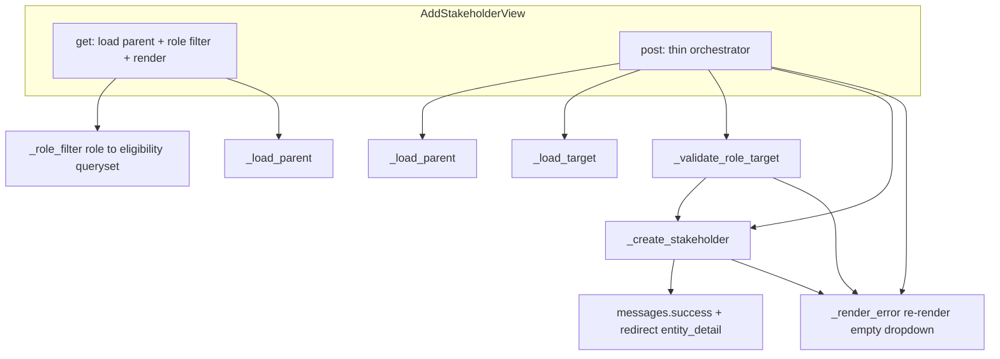

# Plan: Refactor `AddStakeholderView` — Split Methods, Reuse Common Code, Improve Readability

**Status:** ✅ IMPLEMENTED (2026-09-01) — see "Implementation Notes" below.
**Scope:** Pure structural refactor of [`apps/app_entity/views/add_stakeholder.py`](apps/app_entity/views/add_stakeholder.py:1). No behavior change, no schema/migration changes, no spec edits, no template/forms changes, no new dependencies.
**Target file:** `apps/app_entity/views/add_stakeholder.py` (plus optional tiny shared helper module — see Notes).

---

## 1. Current State

[`AddStakeholderView`](apps/app_entity/views/add_stakeholder.py:11) is a class-based view with four concrete subclasses that only set `role_type` ([`AddVendorView`](apps/app_entity/views/add_stakeholder.py:186), [`AddClientView`](apps/app_entity/views/add_stakeholder.py:192), [`AddWorkerView`](apps/app_entity/views/add_stakeholder.py:198), [`AddShareholderView`](apps/app_entity/views/add_stakeholder.py:204)). The URL wiring maps them to `add_vendor`, `add_client`, `add_worker`, `add_shareholder` in [`apps/app_entity/urls.py`](apps/app_entity/urls.py:28).

### Flow today

- **`_load_parent(parent_entity_id)`** ([add_stakeholder.py:21](apps/app_entity/views/add_stakeholder.py:21)) — loads the parent `Entity` with `pk=parent_entity_id, is_internal=True` via `get_object_or_404`; on `Http404` writes an error + audit log, sets a `messages.error`, and re-raises. Already a separate method.
- **`_render_form(parent_project, available_entities, role_type)`** ([add_stakeholder.py:50](apps/app_entity/views/add_stakeholder.py:50)) — renders `app_entity/stakeholder_form.html` with `project_entity`, `entities`, `role_type`, `role_name` (`role_type.capitalize()`).
- **`get()`** ([add_stakeholder.py:62](apps/app_entity/views/add_stakeholder.py:62)) — loads the parent, then a **5-branch if/elif** maps `role_type` → eligibility queryset (`worker`→`is_worker`, `shareholder`→`is_shareholder`, `vendor`→`is_vendor`, `client`→`is_client`, else `.none()`), excludes the host project, and renders.
- **`post()`** ([add_stakeholder.py:87](apps/app_entity/views/add_stakeholder.py:87)) — **the long method (97 lines)** mixing four responsibilities:
  1. load parent project (via `_load_parent`);
  2. load the selected target (`Entity` with `pk=target_id, active=True`, `get_object_or_404` at [add_stakeholder.py:97](apps/app_entity/views/add_stakeholder.py:97));
  3. **role-based validation** ([add_stakeholder.py:109](apps/app_entity/views/add_stakeholder.py:109)) — worker/shareholder must be a Person; vendor must have `is_vendor`; client must have `is_client`; builds `validation_details` and, on failure, logs + audits + `messages.error("Configuration Error: ...")`;
  4. **creation** ([add_stakeholder.py:139](apps/app_entity/views/add_stakeholder.py:139)) — `Stakeholder.objects.get_or_create(parent, target, role)` with `created_status` logging/audit, an `except Exception` block that logs/audits/messages and re-renders, then success message + redirect to `entity_detail`.
  - Both the validation-failure path ([add_stakeholder.py:183](apps/app_entity/views/add_stakeholder.py:183)) and the exception path ([add_stakeholder.py:176](apps/app_entity/views/add_stakeholder.py:176)) end in the **same** `return self._render_form(parent_project, Entity.objects.none(), role_type)` — note the eligible dropdown is rendered empty on error (existing behavior, must be preserved).

### Duplication / sharing with sibling views

- **`EditStakeholderView`** ([`apps/app_entity/views/edit_stakeholder.py`](apps/app_entity/views/edit_stakeholder.py:10)) — loads a `Stakeholder` by `pk` (not a project), renders the **same** template with `is_edit=True`, and handles `notes`/`active` fields. Its loading model, POST fields, validation, messages, and redirect differ from the add view. **Common code between the two is limited to the shared template** — there is no meaningful logic block worth extracting into a shared helper (see §3).
- **`AddContactInfoView` / `EditContactInfoView`** ([`add_contact_info.py`](apps/app_entity/views/add_contact_info.py:12), [`edit_contact_info.py`](apps/app_entity/views/edit_contact_info.py:11)) — contact-info domain (separate model `ContactInfo`), no shared code with the stakeholder views. **Not a reuse target.**
- **`project_setup_wizard.py`** — the **real reuse target**. It already contains module-level helpers that overlap with the add view's role logic:
  - [`_role_filter(role_type)`](apps/app_entity/views/project_setup_wizard.py:498) — role → eligibility kwargs (`is_worker`/`is_vendor`/`is_shareholder` + `active`). It currently lacks the `client` branch (the wizard only handles worker/vendor/shareholder steps).
  - [`_create_stakeholders(entity, role_type, selected_ids)`](apps/app_entity/views/project_setup_wizard.py:510) — bulk `get_or_create(parent, target, role)` loop, **silently skipping** ineligible targets.
  - [`_stakeholder_context(entity, role)`](apps/app_entity/views/project_setup_wizard.py:705) — eligible + existing-id context for steps 4/5/6.
  - The add view's `get()` duplicates the same role→flag mapping the wizard's `_role_filter` encodes; the `get_or_create(parent, target, role)` call in `post()` mirrors the wizard's per-link creation. **However**, the wizard's helpers use silent-skip semantics and multi-select inputs, while the add view needs explicit per-role error messages and a single target — so they cannot be reused verbatim without changing behavior.

### Prior plans

- [`ai-plans/long-function-refactor-phase-2-plan.md`](ai-plans/long-function-refactor-phase-2-plan.md:57) **Phase 1** already targets exactly this: split `AddStakeholderView.post()` into `_load_parent_project`, `_validate_role_target`, `_create_stakeholder`, `_available_entities`. It is **not** recorded in [`ai-plans/IMPLEMENTED_PLANS_SUMMARY.md`](ai-plans/IMPLEMENTED_PLANS_SUMMARY.md:1) and the current code still has an un-split 97-line `post()` — so it remains **pending**. This plan refines that Phase 1 with concrete signatures, the `get()` refactor, the role-filter reuse, and the behavior quirks that must be preserved.
- [`ai-plans/long-function-refactor-plan.md`](ai-plans/long-function-refactor-plan.md:1) — completed; its stakeholder dedup was scoped to the wizard (`_role_filter`/`_create_stakeholders`, Phase 3), not the add view.

---

## 2. Spec Check

**Result: No spec covers the `AddStakeholderView` UI behavior directly.**

- [`docs/specs/README.md`](docs/specs/README.md:28) lists an epic `epic_5_entity_stakeholder.md` ("Entity & Stakeholder Management"), but **that file does not exist** in [`docs/specs/`](docs/specs/README.md:1) (verified via directory listing — only `features/{adjustment,financial_period,financial_reports,stock}.md` and the `operations/` tree exist). The `docs/specs/README.md` epic table is stale/referential.
- The stakeholder relationship itself is documented only as a **consumption contract** inside the operation specs. The add view is the tool that produces those relationships, so the specs pin the *shape* of what the view must create:

| Spec | Stakeholder contract it requires (all `active=True`, `parent=project`, `role=<X>`) |
|------|-------------------------------------------------------------------------------------|
| [`docs/specs/operations/op_13_purchase.md`](docs/specs/operations/op_13_purchase.md:127) | Destination must be an **active VENDOR stakeholder** of the source project (VC4). |
| [`docs/specs/operations/op_14_sale.md`](docs/specs/operations/op_14_sale.md:129) | Source must be an **active CLIENT stakeholder** of the destination project (VC2). |
| [`docs/specs/operations/op_11_worker_advance.md`](docs/specs/operations/op_11_worker_advance.md:123) | Destination must be an **active WORKER stakeholder** of the source project (VC3). |
| [`docs/specs/operations/op_3_project_funding.md`](docs/specs/operations/op_3_project_funding.md:171) | Funder must be an **active SHAREHOLDER stakeholder** of the destination project (VC16). |
| [`docs/specs/operations/op_4_project_refund.md`](docs/specs/operations/op_4_project_refund.md:172) | Destination must be an **active SHAREHOLDER stakeholder** of the source project (VC16). |

**Intended-behavior conclusion:** The current [`AddStakeholderView.post()`](apps/app_entity/views/add_stakeholder.py:87) creates exactly these links — `Stakeholder(parent=parent_project, target=target_entity, role=role_type)` via `get_or_create` ([add_stakeholder.py:140](apps/app_entity/views/add_stakeholder.py:140)), and the `Stakeholder` model defaults `active=True` ([`apps/app_entity/models/__init__.py`](apps/app_entity/models/__init__.py:116)). The role validation mirrors the model's `clean()` invariant that worker/shareholder targets must be People ([models/__init__.py:155](apps/app_entity/models/__init__.py:155)) and the entity role flags. **The proposed refactor preserves all of this exactly, so intended behavior is preserved.** No spec edit is required.

**Related but out of scope:** [`ai-plans/world-entity-vendor-client-plan.md`](ai-plans/world-entity-vendor-client-plan.md:1) (pending user decision) would relax the *operation* stakeholder checks for the World entity — it does not change the add-stakeholder view, so this refactor is unaffected.

---

## 3. Proposed Refactor

Goal: shrink `post()` (97 → ~15 lines) and `get()` (24 → ~8 lines) by extracting single-responsibility helpers, and make the role→eligibility mapping a single local source of truth. All messages, audit strings, redirects, and the two empty-dropdown error renders are preserved verbatim.

### Target structure (Mermaid)



### Step 1 — Add a module-level role→eligibility helper

Extract the 5-branch if/elif in `get()` ([add_stakeholder.py:67](apps/app_entity/views/add_stakeholder.py:67)) into a module-level function in the same file:

```python
def _role_filter(role_type):
    """Eligibility queryset filter kwargs for a stakeholder role."""
    if role_type == "worker":
        return {"is_worker": True, "active": True}
    if role_type == "shareholder":
        return {"is_shareholder": True, "active": True}
    if role_type == "vendor":
        return {"is_vendor": True, "active": True}
    if role_type == "client":
        return {"is_client": True, "active": True}
    return None
```

`get()` then becomes:

```python
def get(self, request, *args, **kwargs):
    parent_project = self._load_parent(kwargs["parent_entity_id"])
    role_type = self.role_type
    filter_kwargs = _role_filter(role_type)
    available = (
        Entity.objects.filter(**filter_kwargs).exclude(id=parent_project.id)
        if filter_kwargs
        else Entity.objects.none()
    )
    logger.debug(...)  # keep the existing count debug log
    return self._render_form(parent_project, available, role_type)
```

Notes:
- `client` must be included (the wizard's `_role_filter` does **not** have it — keep this local, do not import the wizard's to avoid changing wizard behavior).
- Exact same querysets and host exclusion as today.

### Step 2 — Extract `_load_target(request, target_id)`

Move the `get_object_or_404(Entity, pk=target_id, active=True, error_message=...)` block ([add_stakeholder.py:97](apps/app_entity/views/add_stakeholder.py:97)) with its debug log into a method:

```python
def _load_target(self, request, target_id):
    target_entity = get_object_or_404(
        Entity,
        pk=target_id,
        active=True,
        error_message="Entity not found or is not active.",
    )
    logger.debug(...)  # keep existing target debug log
    return target_entity
```

### Step 3 — Extract `_validate_role_target(request, role_type, target_entity)`

Move the validation block ([add_stakeholder.py:109](apps/app_entity/views/add_stakeholder.py:109)) into a method returning `(error_msg, validation_details)`; when `error_msg` is set it also performs the existing `logger.warning` + `audit_logger.info` + `messages.error(...)`:

```python
def _validate_role_target(self, request, role_type, target_entity):
    error_msg = None
    validation_details = { ... }  # unchanged dict
    if role_type == "worker" and not target_entity.is_person:
        error_msg = "Only People can be assigned as Workers."
        validation_details["error_reason"] = "not_a_person"
    elif role_type == "shareholder" and not target_entity.is_person:
        error_msg = "Only People can be assigned as Shareholders."
        validation_details["error_reason"] = "not_a_person"
    elif role_type == "vendor" and not target_entity.is_vendor:
        error_msg = f"{target_entity} is not configured as a Vendor."
        validation_details["error_reason"] = "not_configured_as_vendor"
    elif role_type == "client" and not target_entity.is_client:
        error_msg = f"{target_entity} is not configured as a Client."
        validation_details["error_reason"] = "not_configured_as_client"

    if error_msg:
        logger.warning(f"Stakeholder validation failed | {validation_details}")
        audit_logger.info(
            f"stakeholder_validation_failed | Stakeholder:None | "
            f"user={request.user.username} | {validation_details}"
        )
        messages.error(request, f"Configuration Error: {error_msg}")
    return error_msg, validation_details
```

### Step 4 — Extract `_create_stakeholder(request, parent_project, target_entity, role_type)`

Move the `get_or_create` + audit + exception handling ([add_stakeholder.py:139](apps/app_entity/views/add_stakeholder.py:139)) into a method that returns a redirect on success and `None` on exception (the caller re-renders the error form):

```python
def _create_stakeholder(self, request, parent_project, target_entity, role_type):
    try:
        stakeholder, created = Stakeholder.objects.get_or_create(
            parent=parent_project, target=target_entity, role=role_type,
        )
        # keep created_status debug + audit log verbatim
        messages.success(request, f"Successfully added {role_type}: {target_entity}")
        return redirect("entity_detail", pk=parent_project.id)
    except Exception as e:
        # keep error_details build + logger.error + audit_logger.error verbatim
        messages.error(request, f"Error creating stakeholder: {str(e)}")
        return None
```

### Step 5 — Extract `_render_error(parent_project, role_type)`

The duplicated `return self._render_form(parent_project, Entity.objects.none(), role_type)` ([add_stakeholder.py:176](apps/app_entity/views/add_stakeholder.py:176) and [add_stakeholder.py:183](apps/app_entity/views/add_stakeholder.py:183)) becomes a one-line helper:

```python
def _render_error(self, parent_project, role_type):
    return self._render_form(parent_project, Entity.objects.none(), role_type)
```

### Step 6 — Rewrite `post()` as a thin orchestrator

```python
def post(self, request, *args, **kwargs):
    parent_project = self._load_parent(kwargs["parent_entity_id"])
    role_type = self.role_type
    logger.debug(...)  # keep the existing processing debug log
    target_entity = self._load_target(request, request.POST.get("target_entity"))

    error_msg, _ = self._validate_role_target(request, role_type, target_entity)
    if error_msg:
        return self._render_error(parent_project, role_type)

    response = self._create_stakeholder(request, parent_project, target_entity, role_type)
    if response is not None:
        return response
    return self._render_error(parent_project, role_type)
```

### Cross-file reuse — recommendation

- **Do NOT** create a shared mixin/helper for `AddStakeholderView` + `EditStakeholderView`. They share only the template; their loaders, fields, validation, messages, and redirects differ. Forcing a shared abstraction would be over-engineering for two views.
- **Do NOT** reuse the wizard's `_role_filter` / `_create_stakeholders` (silent-skip, multi-select semantics) — behavior differs. Keep the new local `_role_filter` in `add_stakeholder.py`.
- **Optional follow-up (needs confirmation, see Notes):** extract a tiny shared module `apps/app_entity/views/stakeholder_helpers.py` containing `role_filter(role_type)` (now including `client`) and a single-link `create_stakeholder(parent, target, role)` used by both `add_stakeholder.py` and `project_setup_wizard.py`. This touches the wizard and is out of the "small, focused" scope unless approved.

### Behavior-preservation guardrails

- Keep every `messages.*`, `logger.*`, `audit_logger.*` string identical.
- Keep the **empty-dropdown error re-render** (`Entity.objects.none()`) — this is existing behavior, not a bug to fix here.
- Keep `role_name = role_type.capitalize()` in `_render_form`.
- Keep the success message even when `get_or_create` returns `created=False` (duplicate add is a no-op but still reports success).
- Keep the four subclass definitions and the `views/__init__.py` exports untouched.

---

## 4. Testing

### Existing tests that must keep passing (no direct add-stakeholder view tests exist)

A repo-wide search (`add_vendor|add_client|add_worker|add_shareholder|AddStakeholderView|stakeholder_form|edit_stakeholder|target_entity` in `*test*.py`) found **no direct tests for `AddStakeholderView` or `EditStakeholderView`**. The closest existing coverage, which guards the same `Stakeholder` model invariants the view relies on:

- `apps/app_entity/tests/test_project_setup_wizard_project_setup_wizard_step4.py` (worker), `..._step5.py` (vendor), `..._step6.py` (shareholder), `..._integration.py` — exercise the shared stakeholder creation path in the wizard.
- `apps/app_entity/tests/test_views_get_entity_detail_view.py` — `test_entity_detail_with_stakeholders` renders a detail page with a vendor stakeholder.
- Operation create suites that pin the stakeholder-link contracts the view must satisfy:
  - `apps/app_operation/tests/operations/purchase/test_purchase_create.py` (vendor stakeholder VC4),
  - `apps/app_operation/tests/operations/sale/test_sale_sale_create.py` (client stakeholder VC2),
  - `apps/app_operation/tests/operations/worker/test_worker_advance_worker_advance_create.py` (worker stakeholder VC3),
  - `apps/app_operation/tests/operations/funding/test_project_funding_project_funding_create.py` and `..._project_refund_*` (shareholder VC16).
  - These create `Stakeholder` records directly (they do not hit the view) but validate the model contract the refactored view still produces.

Run order per repo rules (`.roo/rules/testing.md`):
1. `manage.py check` (and `manage.py makemigrations --check` → must show no changes).
2. Targeted: `manage.py test apps.app_entity.tests apps.app_operation.tests.operations.purchase.test_purchase_create apps.app_operation.tests.operations.sale.test_sale_sale_create apps.app_operation.tests.operations.worker.test_worker_advance_worker_advance_create apps.app_operation.tests.operations.funding --parallel=10 --keepdb` (capture output to a temp file under `tmp/`, inspect, delete).
3. Full app suite: `manage.py test --parallel=10 --keepdb` (do **not** run `ui_tests/` unless asked).

### New tests to add (recommended, in `apps/app_entity/tests/`)

Add a focused `test_add_stakeholder_view.py` covering:

- **GET** renders `stakeholder_form.html` with only eligible entities for the role (vendor/client/worker/shareholder) and excludes the host project.
- **POST** with an eligible target creates `Stakeholder(parent=project, target=target, role=role, active=True)` and redirects to `entity_detail`.
- **POST duplicate** — second submission does not create a second row (`get_or_create`) and still returns the success message + redirect.
- **POST ineligible target** — e.g. non-Person for worker → 200 re-render with "Configuration Error", no `Stakeholder` row created.
- **POST non-internal parent** → 404 + error message (via `_load_parent`).
- **POST inactive/missing target** → 404 (via `_load_target`).
- **POST with role lacking eligible entities** (unknown role) → renders empty dropdown (guards the `_role_filter` `None` branch).

These new tests do not change behavior; they pin the refactor.

---

## 5. Notes / Open Questions

1. **Shared helper vs. local duplication (needs confirmation):** The plan keeps the role→eligibility map local to `add_stakeholder.py` (with `client` added). The alternative is a shared `apps/app_entity/views/stakeholder_helpers.py` consumed by both `add_stakeholder.py` and `project_setup_wizard.py` — cleaner reuse but touches the wizard and expands scope. **Default: local helper now; shared module as a separate follow-up.**
2. **Preserved quirk:** On validation failure or exception, the form re-renders with an **empty** eligible-entity dropdown (`Entity.objects.none()`). This looks like a latent UX bug but is existing behavior — the refactor preserves it. Confirm whether to also file a separate bug-fix plan (out of scope here).
3. **No contact-info reuse:** `add_contact_info.py` / `edit_contact_info.py` share nothing with the stakeholder views; they were reviewed and ruled out as reuse targets.
4. **Phase-2 plan overlap:** This plan supersedes/refines Phase 1 of [`ai-plans/long-function-refactor-phase-2-plan.md`](ai-plans/long-function-refactor-phase-2-plan.md:57). If approved, mark that Phase 1 as done there (or note completion here).
5. **`role_type` on class:** The four subclasses only set `role_type`; no change needed to the `role_type: str` annotation or subclass definitions.
6. **No spec edit required** — see §2. If the team wants the add-stakeholder UI behavior codified, creating `docs/specs/features/entity_stakeholder.md` (referenced but missing in `docs/specs/README.md`) would be a separate documentation task.

---

## Implementation Notes (added 2026-09-01 after executing the plan)

- Refactored [`apps/app_entity/views/add_stakeholder.py`](apps/app_entity/views/add_stakeholder.py:1):
  - Added module-level `_role_filter(role_type)` (includes the `client` branch).
  - `get()` now delegates the role→queryset mapping to `_role_filter` and is ~10 lines.
  - `post()` is now a thin orchestrator (~20 lines) using `_load_target`,
    `_validate_role_target`, `_create_stakeholder`, and `_render_error`.
  - `_render_error(parent_project, role_type)` centralises the duplicated
    `Entity.objects.none()` error re-render.
  - All `messages.*`, `logger.*`, `audit_logger.*` strings, the empty-dropdown
    error render, the duplicate-add success message, the four subclass definitions,
    and the `views/__init__.py` exports are unchanged.
- **Pre-existing bug found & fixed (behavior fix, not part of the pure refactor):**
  the FBV→CBV conversion (commit `877c536`) changed the URL kwargs for the four
  `add-*` routes to `pk` ([`apps/app_entity/urls.py:28`](apps/app_entity/urls.py:28)),
  but the view still read `kwargs["parent_entity_id"]`, so every request raised
  `KeyError` → 500. Fixed `get()`/`post()` to read `kwargs["pk"]`, restoring the
  spec-pinned intended behavior (creating active stakeholder links). The templates
  already passed `entity.id` positionally, so no template/URL changes were needed.
- Added [`apps/app_entity/tests/test_add_stakeholder_view.py`](apps/app_entity/tests/test_add_stakeholder_view.py:1)
  (11 tests): `_role_filter` mapping incl. unknown-role `None`; GET eligibility per
  role + host exclusion; GET unknown-role empty dropdown; POST create + redirect;
  POST duplicate no-op; POST non-person worker rejected; POST non-vendor rejected;
  POST non-internal parent 404; POST missing/inactive target 404.
- Verification: `manage.py check` OK; `manage.py makemigrations --check` → no
  changes; new suite `apps.app_entity.tests.test_add_stakeholder_view` 11/11 OK;
  guardrail run (app_entity + purchase/sale/worker/funding create) 275 OK; full
  non-UI suite (all `apps.*` except `ui_tests`) **1391 OK**. The `ui_tests/`
  Selenium failures seen in a full `manage.py test` are pre-existing/environmental
  and unrelated to this change.
- Phase 1 of [`ai-plans/long-function-refactor-phase-2-plan.md`](ai-plans/long-function-refactor-phase-2-plan.md:57)
  is now complete (superseded by this plan); marked done there.

---

## Out of Scope

- No changes to `EditStakeholderView`, contact-info views, wizard views, templates, forms, models, or URLs.
- No spec file edits.
- No behavior changes (including the empty-dropdown error re-render and the duplicate-add success message).
