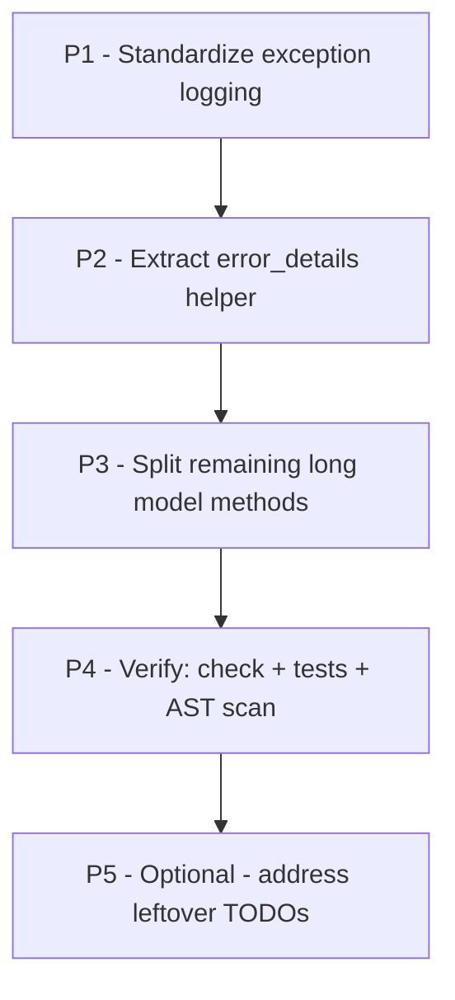

# Plan: Fresh Refactor Scan — Current Code Needing Refactoring

## Objective

A fresh, from-source scan of the current codebase to identify code that **needs
refactoring** (long functions, duplicated blocks, dead code, raw `traceback`
calls, leftover TODOs) and produce a **prioritized refactor plan**. This is a
planning document only — no code changes are made here.

Scope is limited to what a fresh scan surfaces. Items already fully implemented
by prior plans are explicitly listed as "do NOT redo".

---

## Current State (context — do NOT redo)

Extensive refactoring is already complete and documented in
[`ai-plans/IMPLEMENTED_PLANS_SUMMARY.md`](ai-plans/IMPLEMENTED_PLANS_SUMMARY.md:1)
and the phase-2 addendum ([`ai-plans/long-function-refactor-phase-2-plan.md`](ai-plans/long-function-refactor-phase-2-plan.md:394)):

- FBV → CBV conversion (all views class-based).
- Long-function phase-2/10 pass: 1471 tests OK, no new ≥80-line functions.
- Standard-logging migration (custom debug/audit machinery replaced by
  `logging`), dead-code cleanup, mixins extraction (`OneShotTransactionMixin`,
  `InventoryOperationMixin`, `StockEventMixin`), `AddStakeholderView` split,
  `Entity.profit_loss` 109→70, seed `_create_product_templates` 140→80.

Anything listed in the phase-2 plan's "Out of Scope" that was **intentionally
left untouched** (e.g. `Transaction.create` / `Transaction.reverse`,
`_handle_stakeholder_post` / `_handle_step_6_post`) is a **candidate here** only
if it is worth revisiting — see Priority 3.

---

## Scan Findings (from source, 2026-09-01)

### 1. Raw `traceback.print_exc()` calls — 12 sites (conflicts with logging standard)

The project migrated to **standard Python logging** ([`apps/app_base/logging_utils.py`](apps/app_base/logging_utils.py:1)
provides `logger` + `audit_logger`). Raw `traceback.print_exc()` to stdout is
inconsistent with that standard and bypasses log configuration:

| File | Lines |
|------|-------|
| [`apps/app_inventory/views.py`](apps/app_inventory/views.py:485) | 485, 574, 692, 767, 818, 991, 1072, 1211 |
| [`apps/app_base/reversal.py`](apps/app_base/reversal.py:103) | 103 |
| [`apps/app_operation/views/record_transaction.py`](apps/app_operation/views/record_transaction.py:85) | 85 |
| [`apps/app_operation/views/create_operation/evaluation.py`](apps/app_operation/views/create_operation/evaluation.py:145) | 145 |
| [`apps/app_operation/views/create_operation/base.py`](apps/app_operation/views/create_operation/base.py:313) | 313 |

**Recommendation:** replace each with `logger.exception("...")` (or
`logger.error(..., exc_info=True)`), preserving the existing audit-logger +
message behavior that surrounds them.

---

### 2. Duplicated `error_details = {...}` blocks — 25+ sites

A near-identical pattern repeats across views: `except Exception as e:` →
`error_details = {"exception_type": type(e).__name__, "error_message": str(e), ...}`
→ `logger.error(...)` → `audit_logger.error(...)` → `messages.error(...)`. Found
in at least 25 sites:

- `apps/app_entity/views/add_stakeholder.py:140`, `add_contact_info.py:84`,
  `edit_stakeholder.py:73`, `edit_contact_info.py:86`, `person_create.py:55`,
  `person_edit.py:87`, `project_edit.py:87`
- `apps/app_entity/views/project_setup_wizard.py:214, 332, 408, 495, 625`
- `apps/app_entity/views/category/category_bulk_assign.py:130`,
  `category_relation_edit.py:138`
- `apps/app_base/reversal.py:104`
- `apps/app_operation/views/record_transaction.py:86`, `period.py:167`,
  `edit.py:94`, `create_operation/base.py:316`, `create_operation/evaluation.py:147`

**Recommendation:** extract a single shared helper (e.g. in
[`apps/app_base/logging_utils.py`](apps/app_base/logging_utils.py:1) or a new
`apps/app_base/errors.py`), e.g.:

```python
def log_error_details(*, logger, audit_logger, request, label, exc, audit_key, **extra)
```

that builds `error_details`, writes `logger.error` + `audit_logger.error`, and
returns the dict. Message/audit strings must stay byte-for-byte identical.

---

### 3. Remaining long functions (models/helpers — still ≥40 lines)

From the phase-2 addendum + fresh verification. These were intentionally left
untouched or are still large:

| Function | File:line | Lines |
|----------|-----------|-------|
| [`SaleOperation.create_from_session()`](apps/app_operation/models/proxies/op_sale.py:98) | op_sale.py:98 | 99 (was 155) |
| [`Command._create_product_templates()`](apps/app_base/management/commands/seed.py:361) | seed.py:361 | 80 (was 140) |
| [`Transaction.create()`](apps/app_transaction/models.py:119) | models.py:119 | 71 |
| [`Transaction.reverse()`](apps/app_transaction/models.py:192) | models.py:192 | 80 |
| [`Operation.clean()`](apps/app_operation/models/operation.py:952) | operation.py:952 | 68 |
| [`Operation.resolve_request()`](apps/app_operation/models/operation.py:597) | operation.py:597 | 67 |
| [`Operation.save()`](apps/app_operation/models/operation.py:1021) | operation.py:1021 | ~57 |
| [`get_navigation_context()`](apps/app_base/navigation.py:221) | navigation.py:221 | 68 |
| [`create_payment_transaction()`](apps/app_base/mixins.py:364) | mixins.py:364 | 68 |
| [`_handle_stakeholder_post()`](apps/app_entity/views/project_setup_wizard.py:567) | wizard.py:567 | 81 |

---

### 4. TODO markers / deferred design debt (documented, mostly out of scope here)

- `apps/app_transaction/models.py:24-27`, `apps/app_base/models.py:20-21`,
  `apps/app_base/managers.py:4-6`, `apps/app_operation/models/operation.py:27-29`
  — "use database level constraints for data integrity / add financial period
  closing / Financial Statement method / Integrity check method". These are
  **feature/design debt**, not pure refactors — out of scope unless requested.
- `apps/app_inventory/forms.py:393-406` — consumption/death product filtering
  TODOs tied to specs (`op_19_consumption.md`, `op_18_death.md`).
- `apps/app_operation/urls.py:31` — `TODO(spec)` no-product `/evaluate/` route.
- `apps/app_inventory/urls.py:5,50` — TODO comments about template views.

---

## Prioritized Refactor Plan



### Priority 1 — Replace raw `traceback.print_exc()` with structured logging
**Pure refactor, low risk, high consistency value.**

- Replace all 12 raw `traceback.print_exc()` calls with `logger.exception(...)`
  (keeps surrounding behavior/audit/messages).
- Use a consistent message format that includes the failing context label.
- **Files:** [`apps/app_inventory/views.py`](apps/app_inventory/views.py:485),
  [`apps/app_base/reversal.py`](apps/app_base/reversal.py:103),
  [`apps/app_operation/views/record_transaction.py`](apps/app_operation/views/record_transaction.py:85),
  [`apps/app_operation/views/create_operation/evaluation.py`](apps/app_operation/views/create_operation/evaluation.py:145),
  [`apps/app_operation/views/create_operation/base.py`](apps/app_operation/views/create_operation/base.py:313).
- **Tests:** run the affected views' suites (inventory movement/consume/deferred,
  reversal, record-transaction, evaluation, operation-create).

### Priority 2 — Extract a shared `error_details` logging helper
**Pure refactor; removes ~25 duplicated blocks; must preserve strings exactly.**

- Add `log_error_details(...)` to [`apps/app_base/logging_utils.py`](apps/app_base/logging_utils.py:1)
  (or new `apps/app_base/errors.py`).
- Refactor the 25+ call sites to delegate to it, keeping `logger.error` /
  `audit_logger.error` / `messages.error` text and audit keys identical.
- **Tests:** entity views (stakeholder/contact/person/project), wizard steps,
  category views, reversal, record-transaction, period close, operation create.

### Priority 3 — Split remaining long model/view methods (≥40 lines)
**Pure refactor; higher care (heavily tested / spec-pinned domain code).**

Split each into single-responsibility helpers while preserving behavior:

- `Transaction.create()` / `Transaction.reverse()` — extract
  `_resolve_transaction_date(date)` (duplicated in both), `_validate_reversible()`
  guards, and the audit-log orchestration. **Note:** previously explicitly
  deferred ("audited heavily"); include only if approved.
- `Operation.clean()` — extract `_validate_entities_active()`,
  `_validate_closed_period()`, `_validate_category()`.
- `Operation.save()` — extract `_assign_period_if_new()` (the period auto-assign
  block).
- `Operation.resolve_request()` — extract `_resolve_role_entity(role)` / entity
  lookups.
- `get_navigation_context()` — extract `_build_parent_nav()` / `_build_related()`.
- `create_payment_transaction()` — extract `_check_closed_period()` /
  `_check_balance()` / `_check_one_shot()` guards.
- `_handle_stakeholder_post()` — reuse `_project_not_found` guard + Priority 2
  helper to slim the error path.
- Optionally continue shrinking `SaleOperation.create_from_session()` and seed
  `_create_product_templates()` if line counts are still high.

**Tests:** full operation/transaction/entity/inventory suites.

### Priority 4 — Verification (no regression)
Per repo rules ([`AGENTS.md`](AGENTS.md), `.roo/rules/testing.md`):

1. `manage.py check` after each phase.
2. `manage.py makemigrations --check` — must show **no changes** (pure refactor).
3. Targeted tests per phase, then full app suite:
   `manage.py test --parallel=10 --keepdb` (capture to `tmp/`, inspect, delete).
   Do **not** run `ui_tests/` unless asked.
4. Re-run AST scan: `.venv/bin/python tmp/find_long_functions.py --threshold 40`
   to confirm target line counts drop and no new ≥80-line functions appear.
5. Grep to confirm single definition of each extracted helper.

### Priority 5 — Optional: leftover TODO / design debt
Document-only unless explicitly requested (DB constraints, financial period
closing, `Financial Statement` method, spec-tied form TODOs).

---

## Implementation Notes — 2026-09-01 (Priority 1 & 2 done)

Implemented as a **pure refactor** (no behavior/schema/spec/dependency changes).
Verified with `manage.py check` (no issues), `manage.py makemigrations --check`
("No changes detected"), and the full non-UI suite: **1469 tests OK**
(`apps.app_entity/app_inventory/app_base/app_operation/app_adjustment` → 1384,
`apps.app_transaction/app_report` → 85; `ui_tests/` not run per repo policy).

- **Priority 1** — replaced all **12 raw `traceback.print_exc()`** calls with
  `logger.exception(...)` in [`apps/app_inventory/views.py`](apps/app_inventory/views.py:1),
  [`apps/app_base/reversal.py`](apps/app_base/reversal.py:103),
  [`apps/app_operation/views/record_transaction.py`](apps/app_operation/views/record_transaction.py:84),
  [`apps/app_operation/views/create_operation/evaluation.py`](apps/app_operation/views/create_operation/evaluation.py:145),
  [`apps/app_operation/views/create_operation/base.py`](apps/app_operation/views/create_operation/base.py:313);
  removed the now-unused `import traceback` from `app_inventory/views.py`,
  `record_transaction.py`, `evaluation.py`, `base.py` (`reversal.py` keeps it for
  `traceback.format_exc()`).
- **Priority 2** — added
  [`build_error_details()`](apps/app_base/logging_utils.py:18) to
  [`apps/app_base/logging_utils.py`](apps/app_base/logging_utils.py:1) and
  refactored the **25+ duplicated `error_details = {...}` blocks** to delegate to
  it (entity views: add/edit stakeholder, add/edit contact, person create/edit,
  project edit; wizard steps 1–6; category bulk-assign + relation-edit;
  reversal; record-transaction; operation edit; evaluation; operation-create).
  `logger.error` / `audit_logger.error` / `messages.error` strings and audit keys
  are preserved byte-for-byte. The `form_errors`/`field_errors`/`validation_errors`
  dicts are a different (non-exception) shape and were intentionally left as-is.

Remaining priorities (3–5) are not implemented in this pass; see the phases above.

---

## Out of Scope

- No behavior changes, no schema/migration changes, no spec edits, no new
  dependencies.
- Do NOT redo already-completed phases (listed under Current State).
- `Transaction.create` / `Transaction.reverse` only if Priority 3 explicitly
  approved.
- TODO markers that are design/feature debt stay documented, not implemented.
