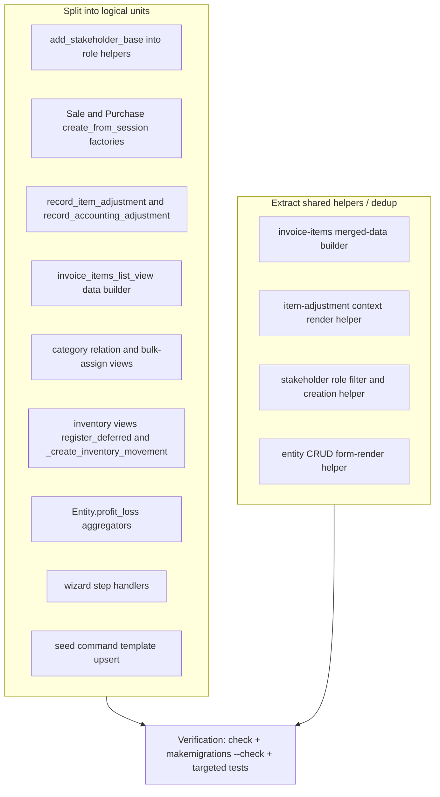

# Plan: Long Function Refactor — Phase 2 (Remaining Offenders)

## Objective

A pure refactor pass over the **long functions/methods still present** after the
completed Phase 1 plan ([`ai-plans/long-function-refactor-plan.md`](ai-plans/long-function-refactor-plan.md:1)
— marked ALL PHASES COMPLETE, 1460 tests OK).

An AST scan of [`apps/`](apps/__init__.py:1) and [`farm/`](farm/__init__.py:1)
(excluding migrations/tests/venv) found **103 functions ≥ 40 lines** before the
FBV→CBV conversion, and **99 functions ≥ 40 lines** after it
(re-scan 2026-09-01, see Current-State Addendum below). The prior plan already
handled `InventoryMovementLine.clean`, `OperationCreateView.post`, the wizard
context builder, payment/repayment views, stock active-lines helper,
terminal-status maps, reversal orchestration, `quick_consume`, and
`Operation.create`/`_auto_create_inventory_movements`. This Phase 2 plan targets
the **remaining largest and most duplicated** functions. Because the FBV→CBV
conversion (see [`ai-plans/all-views-class-based-refactor-plan.md`](ai-plans/all-views-class-based-refactor-plan.md:1))
split many views into `get`/`post`/`_handle`, some targets below are now CBV
methods — the split boundaries above still apply, just under new names/lines.

**This is a pure refactor**: no behavior change, no schema/migration changes, no
spec edits, no new dependencies. All existing tests must keep passing. Messages,
redirects, audit/debug calls, and rendered context are preserved exactly.

---

## Target Architecture



---

## Phase 1 — Split `AddStakeholderView.post()` (97 lines)

**Status:** ✅ DONE (2026-09-01) — implemented via
[`ai-plans/add-stakeholder-refactor-plan.md`](ai-plans/add-stakeholder-refactor-plan.md:1);
superseded by that refined plan. `post()` split into `_load_target`,
`_validate_role_target`, `_create_stakeholder`, `_render_error`; `get()` now uses a
module-level `_role_filter` (with the `client` branch). Tests added in
`apps/app_entity/tests/test_add_stakeholder_view.py` (11 tests). Non-UI suite: 1391 OK.

**File:** [`apps/app_entity/views/add_stakeholder.py`](apps/app_entity/views/add_stakeholder.py:87)

The CBV now has a separate `get` (available-entities rendering) and a `post`
(role-based validation + creation) — the 157-line FBV split naturally. The
remaining `post` still mixes three responsibilities: parent-project loading with
audit, role-based POST validation, and stakeholder creation. Extract module-level
helpers:

- `_load_parent_project(request, parent_entity_id)` — the try/except
  `get_object_or_404` block with its `audit_logger.info` + `messages.error` +
  re-raise (moved to `_setup`/helper; 16–35 in the original).
- `_validate_role_target(request, role_type, target_entity)` — the role-based
  validation returning `(error_msg, validation_details)`.
- `_create_stakeholder(request, parent_project, target_entity, role_type)` — the
  `get_or_create` + `created_status` audit + exception handling + success message.
- `_available_entities(role_type, exclude_id)` — the role→queryset filter and
  host exclusion (used by `get`).

`post()` becomes a thin orchestrator: load parent → validate → create → message
/redirect. The four thin wrapper classes (`AddVendorView` etc.) stay unchanged.

**Tests:** `apps.app_entity.tests.test_entity_forms_*`,
`apps.app_entity.tests.test_views_*` (stakeholder/entity views), plus any
stakeholder creation/reversal tests under `apps.app_operation.tests.operations.*`.

---

## Phase 2 — Split `SaleOperation.create_from_session()` / `PurchaseOperation.create_from_session()` (155 / 111 lines)

**Files:**
- [`apps/app_operation/models/proxies/op_sale.py`](apps/app_operation/models/proxies/op_sale.py:98)
- [`apps/app_operation/models/proxies/op_purchase.py`](apps/app_operation/models/proxies/op_purchase.py:105)

Both factories run the same 6-stage pipeline (integrity → operation record →
invoice items → inventory movement lines → payment). They already share
`_validate_item_totals`, `_build_invoice_items`, `process_payment`. The remaining
duplication/length is in the **movement-line loops**, which differ only in the
INDIVIDUAL-expansion branch vs the flat create.

**Action:** extract a shared helper for the movement-line creation that both
factories delegate to, e.g. in the inventory models or `stock.py`:

```python
def create_received_movement_lines(*, operation, invoice_item, quantity,
                                   date, officer, group_key, lazy_unique_id=None):
```

- Handles `tracking_mode == INDIVIDUAL` (one line per head, qty=1, first head
  takes `lazy_unique_id`, subsequent auto-generate) vs the single flat line.
- Returns the created count.

Sale keeps its own SALE-specific steps (product ownership/availability guard,
`product.invoice_items.add`, buyer-copy loop) — but pull the per-item
`InvoiceItem` + outbound `InventoryMovementLine` creation into a
`_link_sold_product(product, invoice_item, qty, date, officer, group_key)` helper
to shrink the main loop.

Also extract `_resolve_counterparty(cls, session_data)` for the Entity lookup +
`ValidationError` (repeated in both factories).

**Tests:** `apps.app_operation.tests.operations.purchase.*`,
`...sale.*`, `apps.app_inventory.tests.test_inventory_movement`,
`test_invoice`, `test_product`. Verify INDIVIDUAL expansion and lazy product
creation behavior is unchanged.

---

## Phase 3 — Split adjustment views (`RecordItemAdjustmentView.post` 85 / `RecordAccountingAdjustmentView.post` 67 lines)

**Files:**
- [`apps/app_operation/views/adjustment.py`](apps/app_operation/views/adjustment.py:254) (`RecordItemAdjustmentView.post`)
- [`apps/app_operation/views/adjustment.py`](apps/app_operation/views/adjustment.py:129) (`RecordAccountingAdjustmentView.post`)

### 3a. `RecordItemAdjustmentView.post()`
The CBV split already separated `get` (renders the form with `moved_qty` per
item) from `post`. The `post` still rebuilds the error-render context at each
failure point (invalid date, closed period, `parse_item_changes` error, no items
changed, exception). Extract:

- `_item_adjustment_context(operation, items)` → the dict
  `{"operation", "items", "today"}`.
- `_render_item_adjustment(request, operation, items)` → render shortcut that
  sets the context and returns the response.
- `_validate_item_adjustment_post(request, operation, items)` → parses and
  validates `date` (DjangoDateField), the closed-period guard, and
  `parse_item_changes`; returns `(date, reason, changed_items_data)` or a
  rendered error response.

`post()` becomes: guards → `_validate_item_adjustment_post` → atomic create →
messages/redirect. (The `get` keeps its `moved_qty` build loop or delegates it to
a `_item_moved_qty(item)` helper.)

### 3b. `RecordAccountingAdjustmentView.post()`
Same context-rebuild duplication across the GET-render, invalid-form, and
exception paths. Extract `_adjustment_context(form, operation)` and reuse. Move
the POST create block into `_create_adjustment(operation, form, request)`
(closed-period guard + `Adjustment` build + `full_clean` + `save`), leaving the
view to handle form errors.

**Tests:** `apps.app_adjustment.tests.*` (validation, immutability, reversal),
`apps.app_operation.tests.views.test_views_*adjustment*`.

---

## Phase 4 — Split `InvoiceItemsListView.get()` (111 lines)

**File:** [`apps/app_operation/views/invoice_items.py`](apps/app_operation/views/invoice_items.py:24)

The `get` is a single data-assembly pipeline: fetch operation → fetch items →
fetch capital valuations → fetch + group adjustment lines → fetch grouped
adjustments → `get_items_data()` → merge → total → context.

**Action:** extract module-level (or `self.`) builders:
- `_fetch_capital_valuations(operation)`.
- `_fetch_item_adjustment_lines(operation)` + `_group_by_item(lines)`.
- `_fetch_grouped_adjustments(operation)`.
- `_merge_items(items, adj_lines_by_item, items_data_by_pk)`.

`get()` becomes a short sequence of these calls plus the `render`. This also
gives `OperationDetailView.get()` (see Phase 9) a reusable merged-items builder
if it renders similar cards.

**Tests:** `apps.app_operation.tests.views.test_views_get_invoice_items_list_view` (or
equivalent), `apps.app_operation.tests.operations.invoice.*`.

---

## Phase 5 — Split category relation / bulk-assign CBVs (`post` 99 / 79 lines)

**Files:**
- [`apps/app_entity/views/category/category_relation_edit.py`](apps/app_entity/views/category/category_relation_edit.py:53) (`CategoryRelationEditView.post`)
- [`apps/app_entity/views/category/category_bulk_assign.py`](apps/app_entity/views/category/category_bulk_assign.py:56) (`CategoryBulkAssignView.post`)

### 5a. `CategoryRelationEditView.post()`
The three POST actions (remove / activate / save) each repeat the same
save→debug-log→audit→message pattern with only the label/fields differing.
Extract:
- `_relation_action_remove(relation)`, `_relation_action_activate(relation)`,
  `_relation_action_save(relation, raw_limit)` — each returns the audit/message
  strings and performs the mutation, OR
- a parameterized `_apply_relation_action(relation, action, raw_limit)` with a
  small per-action table (fields to set, audit verb, success message).
- `_relation_audit(verb, relation, category, parent, **extra)` for the
  `audit_logger.info` line.
- `_relation_error(request, e, relation, category)` for the exception block.

### 5b. `CategoryBulkAssignView.post()`
Read the file first (not shown fully here); expected splits: a
`_load_categories_and_relations(entity)` context builder and a
`_bulk_assign_post(request, entity)` handler extracting the per-row save loop.

**Tests:** `apps.app_entity.tests.test_views_get_entity_detail_view`,
`apps.app_entity.tests.test_entity_list_filters_*`, plus any category-relation
tests under `apps.app_entity.tests`.

---

## Phase 6 — Split inventory CBVs (`StockDetailView.get` 114 / `StockHistoryView.get` 110 / `_InventoryMovementCreateView._handle` 108 / `RegisterDeferredMovementsView.post` 84)

**File:** [`apps/app_inventory/views.py`](apps/app_inventory/views.py:60), (views.py:179), (views.py:691), (views.py:1064)

### 6a. `RegisterDeferredMovementsView.post()` (84 lines)
Extract:
- `_remaining_moveable_qty(invoice_item)` — the `active_lines_for_item` aggregate
  + `invoice_item.quantity - already_moved` (the already-moved block in `post`).
- `_deferred_form_context(form, operation)` and the POST branch into
  `_register_deferred_post(request, operation, form)` returning a response.

### 6b. `_InventoryMovementCreateView._handle()` (108 lines)
Extract the POST parse+guard portion into
`_parse_movement_post(request, operation)` → `(date, notes)` or error-render,
and keep the atomic formset block inline or in
`_create_movement_lines_post(...)`. The `formset` construction is already shared
via `_render_movement_form` — reuse the same constructor in the exception path
via a small `_build_formset(request, operation)` helper.

### 6c. `StockDetailView.get()` (114) / `StockHistoryView.get()` (110)
`stock_detail`/`stock_history` were partially refactored previously
(`_stock_portfolio_rows`, `portfolio_direction_q`, `paginate`). Further-split the
remaining bodies into `_base_products_qs(...)`, `_portfolio_rows(...)` (already
exists), and `_history_rows(...)` / `_history_context(...)` data-assembly helpers.

**Tests:** `apps.app_inventory.tests.test_views_movement_actions`,
`test_views_get_stock_history_view`, `test_views_get_stock_detail_view`,
`test_inventory_movement`.

---

## Phase 7 — Split `Entity.profit_loss()` (109 lines)

**File:** [`apps/app_entity/models/__init__.py`](apps/app_entity/models/__init__.py:471)

The method builds 4 signed sums with duplicated `_signed_sum` filter/aggregate
patterns. Extract module-level (or `@staticmethod`) helpers:
- `_fund_transaction_sum(fund, *, direction, types, tx_valid)` where
  `direction` is `target` or `source` and `types` is the `TransactionType` list;
  keeps the existing inner `_signed_sum` reversal-negation logic.
- `_profit_loss_income_types()` / `_profit_loss_cost_types()` constants (or one
  `PROFIT_LOSS_TYPES` mapping `{"income": [...], "costs": [...]}`) so the four
  filter lists live in one place.

`profit_loss()` becomes: validate project fund → build `tx_valid` → compute
income/costs via the helper → return `income - costs`. Keep the docstring and
the `__date` comparison semantics exactly.

**Tests:** `apps.app_report.tests`, `apps.app_entity.tests` (profit/loss-related),
`apps.app_transaction.tests` (issuance/adjustment transaction types).

---

## Phase 8 — Split wizard step handlers in `project_setup_wizard.py`

**File:** [`apps/app_entity/views/project_setup_wizard.py`](apps/app_entity/views/project_setup_wizard.py:116) (92), (wizard.py:215) (100), (wizard.py:322) (72), (wizard.py:421) (70), (wizard.py:533) (81)

The six `_handle_step_N_post()` handlers share repeated patterns: parse POST →
validate → create model objects → `messages.error/success` → redirect. The prior
plan already deduped steps 4/5/6 stakeholder handling via `_handle_stakeholder_post`.

**Action:**
- Extract a small `_post_error(request, entity, step, message)` render/redirect
  helper and a `_parse_*_post` helper per step if the parsing is non-trivial.
- Steps 1/2/3 (categories, templates, personnel-ish) — extract the object-creation
  loops into `_apply_step1_post(...)`, `_apply_step2_post(...)`,
  `_apply_step3_post(...)` that mutate + audit, leaving handlers as parse →
  apply → message/redirect.
- Do **not** re-touch the already-shared stakeholder path (steps 4/5/6).

**Tests:** `apps.app_entity.tests.test_project_setup_wizard_project_setup_wizard_step1..6`,
`..._integration`.

---

## Phase 9 — Split `OperationDetailView.get()` (105 lines) + nav overrides

**File:** [`apps/app_operation/views/detail.py`](apps/app_operation/views/detail.py:59) and (detail.py:12) `_build_navigation_overrides`

The `get` assembles a large context (operation, tabs, reversals, adjustments,
items, movements, navigation overrides, permissions). Extract per-section
builders mirroring the template's blocks:
- `_reversal_context(operation)` — reversal-related flags + alert.
- `_adjustments_context(operation)` — adjustment lists.
- `_items_context(operation)` — reuse `_merge_items` from Phase 4 if the cards
  match `InvoiceItemsListView`.
- `_operation_tabs(request, operation)` — tab/title context (if present).

`_build_navigation_overrides` already exists; keep it but pass a reduced set of
inputs if feasible.

**Tests:** `apps.app_operation.tests.views.test_views_get_operation_detail_view`,
`apps.app_operation.tests.operations.*` (detail rendering after create/reverse).

---

## Phase 10 — Split `Command._create_product_templates()` in the seed command (140 lines)

**File:** [`apps/app_base/management/commands/seed.py`](apps/app_base/management/commands/seed.py:361)

The method has two near-identical get-or-create/update loops (non-animal and
animal templates). Extract:
- `_template_defaults(name, name_ar, nature, unit, tag, sub_cat)` and the
  animal variant `_animal_template_defaults(entry)` — return the `defaults` dict.
- `_upsert_template(template, is_new, defaults)` → returns `(created, updated)`
  increments, folding the manual `changed` field-compare loop (400–431 and
  456–469) into one helper using `defaults` keys.

**Tests:** not unit-tested directly; verify by re-running
`manage.py seed` against an empty/partial DB and checking idempotency + counts
(`manage.py seed --dry-run` if supported). No schema impact.

---

## Phase 11 — (Optional / lower priority) Remaining model methods

These are heavily tested, spec-pinned domain methods; only split if earlier
phases land cleanly and reviewers are comfortable:

- [`Transaction.create()`](apps/app_transaction/models.py:119) (71) /
  [`Transaction.reverse()`](apps/app_transaction/models.py:192) (80) — currently
  explicitly excluded from the prior plan ("audited heavily"). Leave unless
  explicitly requested.
- [`Operation.clean()`](apps/app_operation/models/operation.py:932) (68),
  [`Operation.resolve_request()`](apps/app_operation/models/operation.py:597) (67),
  [`Operation.create()`](apps/app_operation/models/operation.py:741) (58),
  [`Operation.save()`](apps/app_operation/models/operation.py:1001) (57) — the
  prior Phase 8 already extracted create-stages; only split `clean`/`save` into
  `_validate_*` helpers if needed.
- [`get_navigation_context()`](apps/app_base/navigation.py:221) (68) and
  [`LinkedPaymentTransactionMixin.create_payment_transaction()`](apps/app_base/mixins.py:364) (68).

**Tests:** full operation/transaction suites (`apps.app_operation.tests`,
`apps.app_transaction.tests`, `apps.app_base.tests`).

---

## Verification (no regression)

Per repo rules ([`AGENTS.md`](AGENTS.md), `.roo/rules/testing.md`):

1. `manage.py check` after each phase; `manage.py makemigrations --check` must
   show **no** changes (pure refactor).
2. Targeted tests per phase (listed under each phase above), then the full app
   suite: `manage.py test --parallel=10 --keepdb` (capture to a temp file under
   `tmp/`, inspect, delete the temp file). Do **not** run `ui_tests/` unless
   explicitly asked.
3. Re-run the AST scan
   (`.venv/bin/python tmp/find_long_functions.py --threshold 40`) before and
   after to confirm the target line counts drop and no new ≥80-line functions
   are introduced.
4. Grep for extracted helper names to confirm no lingering duplicate definitions.
5. Re-check spec-pinned behaviors (movement INDIVIDUAL expansion, VA3/MR1/MS4
   guards, closed-period guards, reversal semantics) against
   [`docs/specs/`](docs/specs/README.md) — behavior must be unchanged.

---

## Out of Scope

- No behavior changes, no schema/migration changes, no spec edits, no new
  dependencies.
- Do NOT redo Phase 1's completed work (listed in the Context of the prior plan).
- Do not touch `Transaction.create`/`Transaction.reverse` unless Phase 11 is
  explicitly approved.
- `stock_detail`/`stock_history` were partially refactored previously
  (`_stock_portfolio_rows`, `portfolio_direction_q`); only further-split the
  remaining bodies listed here.

---

## Current-State Addendum — 2026-09-01 (after FBV→CBV conversion)

Re-ran the AST scan
(`.venv/bin/python tmp/find_long_functions.py --threshold 40`) after the
FBV→CBV conversion documented in
[`ai-plans/all-views-class-based-refactor-plan.md`](ai-plans/all-views-class-based-refactor-plan.md:1).
**Total: 99 functions/methods ≥ 40 lines** (down from 103 pre-conversion). No
files skipped, no parse errors.

### What the FBV→CBV conversion already improved

The conversion split many single FBVs into `get`/`post`/`_handle` methods, which
reduced per-method size without extra refactoring:

| Before (FBV) | After (CBV) |
|---|---|
| `add_stakeholder_base` 157 | `AddStakeholderView.post` 97 |
| `record_item_adjustment` 121 | `RecordItemAdjustmentView.post` 85 |
| `register_deferred_movements` 114 | `RegisterDeferredMovementsView.post` 84 |
| `stock_detail` 111 | `StockDetailView.get` 114 |
| `invoice_items_list_view` 118 | `InvoiceItemsListView.get` 111 |
| `stock_history` 109 | `StockHistoryView.get` 110 |
| `_create_inventory_movement` 109 | `_InventoryMovementCreateView._handle` 108 |
| `transaction_reverse_view` 107 | `TransactionReverseView._handle` 101 |
| `category_relation_edit_view` 114 | `CategoryRelationEditView.post` 99 |
| `operation_detail_view` 105 | `OperationDetailView.get` 105 |
| `record_accounting_adjustment` 95 | `RecordAccountingAdjustmentView.post` 67 |
| `quick_consume` 90 | `QuickConsumeView.post` 75 |
| `period_close_view` 79 | `PeriodCloseView.post` 44 |
| `entity_payment_transactions_view` 77 | `EntityPaymentTransactionsView.get` 72 |
| `person_edit_view` 90 | `PersonEditView.post` 64 |
| `project_edit_view` 90 | `ProjectEditView.post` 64 |

### Top remaining long functions (unchanged by conversion — models/helpers)

1. [`SaleOperation.create_from_session()`](apps/app_operation/models/proxies/op_sale.py:98) — 155
2. [`Command._create_product_templates()`](apps/app_base/management/commands/seed.py:361) — 140
3. [`PurchaseOperation.create_from_session()`](apps/app_operation/models/proxies/op_purchase.py:105) — 111
4. [`Entity.profit_loss()`](apps/app_entity/models/__init__.py:471) — 109
5. [`InvoiceItemAdjustment.finalize()`](apps/app_adjustment/models.py:417) — 84
6. [`InventoryMovementLine.create_for_operation()`](apps/app_inventory/models.py:1326) — 83
7. [`get_items_data()`](apps/app_operation/models/operation.py:102) — 83
8. [`InvoiceItem.create_movements()`](apps/app_inventory/models.py:531) — 82
9. [`_handle_stakeholder_post()`](apps/app_entity/views/project_setup_wizard.py:533) — 81
10. [`InvoiceItem.create_products_for_item()`](apps/app_inventory/models.py:410) — 80
11. [`Transaction.reverse()`](apps/app_transaction/models.py:192) — 80
12. wizard step handlers in [`project_setup_wizard.py`](apps/app_entity/views/project_setup_wizard.py:116) — 70–100 each (FBVs, excluded from CBV conversion by design)

All Phase targets above were updated to the CBV method names and current line
numbers. The plan's split boundaries are unchanged — they apply to the new
`get`/`post`/`_handle` methods.
