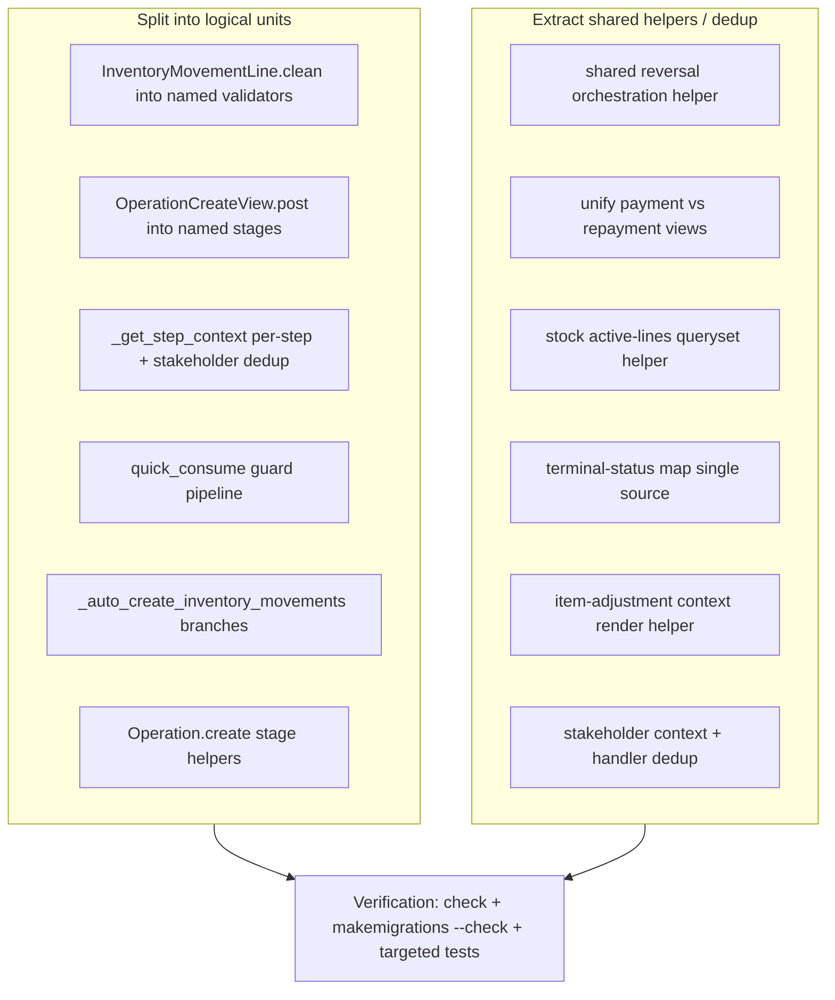

# Plan: Long Function / Method Refactor — Split Units & Extract Shared Helpers

## Objective

A pure refactor pass targeting the **long functions and methods** identified during
analysis, with two goals:

1. **Split into logical abstract units** — decompose long functions into named,
   single-responsibility methods/helpers at the same boundaries the code already
   marks with section comments.
2. **Extract lines into shared helpers used from many paths** — remove duplicated
   blocks across independent code paths so each behavior has a single source of
   truth.

**This is a pure refactor**: no schema/migration changes, no spec edits, no new
dependencies. All existing tests must keep passing. Rendered context, messages,
redirects, and audit/debug calls are preserved exactly.

---

## Context — What is ALREADY done (do NOT redo)

The prior plan [`ai-plans/refactor-cleanup-dead-code-plan.md`](ai-plans/refactor-cleanup-dead-code-plan.md)
already covered long-function work (marked COMPLETE, verified 1460 tests OK):

- `stock_detail` → `_stock_portfolio_rows()` + `stock.portfolio_direction_q()`.
- `_create_inventory_movement` → `_render_movement_form()`.
- `record_transaction_payment` / `record_transaction_repayment` → shared
  `_render_transaction_form()` (render only; the two views still keep their own
  guards and create-calls — see Phase 4 below for the remaining unification).
- `_obligation_context` + `entity_payment_transactions_view` → shared
  `farm.shortcuts.paginate()`.
- `project_setup_wizard.py` dead-code cleanup (duplicate import, no-op step-1 block).

The targets below are **new** or **remaining** items on top of that foundation.
Verify each target's current shape with a quick read before editing, since the
file may have shifted after the earlier phases.

---

## Target Architecture



---

## Phase 1 — Split `InventoryMovementLine.clean()` into named validators

**File:** [`apps/app_inventory/models.py`](apps/app_inventory/models.py:1132) (~112 lines)

The `clean()` method runs six independent cross-field rules. Extract each into a
named `_validate_*` method, mirroring the pattern already used by
[`_validate_availability()`](apps/app_inventory/models.py:1098):

- `_validate_operation_match()` — invoice-item/operation FK consistency (currently 1137–1141).
- `_validate_over_delivery()` — the already-moved budget check (1147–1179).
- `_validate_ownership()` — outbound product ownership guard (1190–1199).
- `_validate_unit_multiple()` — minimum-quantity multiple check (1204–1212).
- `_validate_status_allowance()` — the terminal-status/`validate_active` block
  (1214–1241), including the `terminal_status_by_op` map.

`clean()` becomes a thin orchestrator calling each `_validate_*` in order, then
`super().clean()`. Preserve the `skip-when-fk-unset` early returns exactly.

**Behavior note:** `terminal_status_by_op` (DEATH/SALE/CONSUMPTION → status) is
moved with this method but re-used in Phase 5 (single source of truth) — coordinate
the two phases so the map is hoisted once, not duplicated.

**Tests:** `apps.app_inventory.tests.test_inventory_movement`,
`apps.app_inventory.tests.test_stock`.

---

## Phase 2 — Split `OperationCreateView.post()` into named stages

**File:** [`apps/app_operation/views/create_operation/base.py`](apps/app_operation/views/base.py:154) (~125 lines)

The `post()` method is a 5-stage pipeline (validator → formset → amount → model
create → success/error render). Extract:

- `_validate_post(request)` → parsed data (the `OperationDataValidator` block).
- `_validate_formset(request, date, description, category_id)` → formset or early
  error-render.
- `_create_operation(parsed, amount, date, category_id)` → the atomic
  `proxy_cls.create(...)` call and success redirect.
- `_render_creation_error(request, ..., errors)` → the failure re-render
  (currently 248–278), shared with the formset-invalid path.

`post()` becomes a thin sequence of these calls. No message/context change.

**Tests:** `apps.app_operation.tests.views.test_views_get_operation_create_view`,
`apps.app_operation.tests.operations.*` (create paths), `test_views_birth_create_and_reverse`,
`test_views_death_create_and_reverse`.

---

## Phase 3 — `_get_step_context()` per-step split + stakeholder dedup

**File:** [`apps/app_entity/views/project_setup_wizard.py`](apps/app_entity/views/project_setup_wizard.py:618) (~128 lines)

The context builder dispatches on `step` and duplicates the eligible/existing
stakeholder query for steps 4/5/6. Extract:

- `_step2_context(entity)` — categories grouping.
- `_step3_context(entity)` — templates.
- `_stakeholder_context(entity, role)` — the shared eligible-entities + existing-
  stakeholder-ids query used by steps 4/5/6 (currently triplicated, 678–736).

Also dedup the POST side: steps 4/5 already delegate to
[`_handle_stakeholder_post()`](apps/app_entity/views/project_setup_wizard.py:512),
but **step 6 re-implements the loop inline** (436–492). Re-point step 6 at
`_handle_stakeholder_post(request, entity, "shareholder", next_step=...)` and
remove the inline copy. Keep the step-6 final completion message + redirect to
`entity_detail` (the generic helper redirects to `project_setup_step` — pass a
small post-step callback or handle the final redirect in the caller).

**Tests:** `apps.app_entity.tests.test_project_setup_wizard_project_setup_wizard_step4`,
`..._step5`, `..._step6`, `..._integration`.

---

## Phase 4 — Unify payment vs repayment recording views (remaining)

**File:** [`apps/app_operation/views/record_transaction.py`](apps/app_operation/views/record_transaction.py)

The earlier phase extracted `_render_transaction_form()`, but the two view bodies
are still ~80% duplicated (guard/log/audit/error handling; only the
`create_payment_transaction` vs `create_repayment_transaction` call, template,
remaining-getter and fund-getter differ).

**Action:** introduce one generic handler, e.g.

```python
def _record_transaction(request, pk, *, create_tx, template, remaining_getter,
                        fund_getter, audit_action, label):
```

and have `record_transaction_payment` / `record_transaction_repayment` become thin
wrappers that pass their specific callables (amount_remaining_to_settle vs
amount_remaining_to_repay, `payment_source_fund` vs `payment_target_fund`).
Preserve each view's distinct pre-guards (`can_repay` / `can_pay`) in the wrappers.

This is the single largest line reduction (~206 → ~90 lines). If the two audit
blocks differ in wording, keep them parameterized rather than collapsing messages.

**Tests:** `apps.app_operation.tests.views.test_views_post_payment_recording_view`,
`test_views_post_repayment_recording_view`, `apps.app_operation.tests.operations.loan.*`,
`...worker.*`, `...purchase.test_purchase_payment`.

---

## Phase 5 — Shared helpers for stock active-lines + terminal-status maps

**File:** [`apps/app_inventory/stock.py`](apps/app_inventory/stock.py) and
[`apps/app_inventory/models.py`](apps/app_inventory/models.py)

### 5a. `active_lines_queryset()` in `stock.py`

The "not a reversal line, not the original of a reversal line" exclusion is
repeated in four places:

- [`active_movements()`](apps/app_inventory/stock.py:31)
- [`active_lines_for_item()`](apps/app_inventory/stock.py:51)
- [`_item_moved_qty()`](apps/app_inventory/stock.py:147)
- the already-moved block in [`InventoryMovementLine.clean()`](apps/app_inventory/models.py:1153)

**Action:** add `active_lines_queryset(*, product=None, invoice_item=None,
as_of=None)` returning the shared filtered `InventoryMovementLine` queryset
(with `select_related("operation")`), and consume it from all four call sites.
`active_movements()` keeps its list conversion; `active_lines_for_item()` and
`_item_moved_qty()` delegate. `clean()` imports and uses it for its already-moved
sub-query. Reversal semantics now live in one place.

### 5b. Single source for the terminal-status map

`TERMINAL_STATUS` / `terminal_status_by_op` (DEATH→DEAD, SALE→SOLD,
CONSUMPTION→CONSUMED) is defined in:

- [`Product.status`](apps/app_inventory/models.py:716)
- [`_status_from_linked_operations()`](apps/app_inventory/models.py:784)
- `InventoryMovementLine.clean()` (via `terminal_status_by_op`, moved in Phase 1)

**Action:** hoist a module-level `TERMINAL_STATUS_BY_OP` constant in
`apps/app_inventory/models.py` (or `stock.py`) and reference it from all three.
Keep the `OperationType` import inside each method or at module level consistently.

**Tests:** `apps.app_inventory.tests.test_stock`, `test_inventory_movement`,
`test_product` (status), `test_views_get_stock_detail_view`, `test_views_get_stock_history_view`.

---

## Phase 6 — Reversal orchestration helper (4 near-identical views)

Four views repeat the same reversal skeleton (guard → reason-required → `reverse()`
→ audit → exception handling → render):

- [`operation_reverse_view()`](apps/app_operation/views/reverse.py:14)
- [`transaction_reverse_view()`](apps/app_transaction/views.py:319)
- [`reverse_adjustment()`](apps/app_operation/views/adjustment.py:300)
- [`reverse_item_adjustment()`](apps/app_operation/views/adjustment.py:403)

The shared guard [`reversal_guard_error()`](apps/app_base/reversal.py) already
exists. **Action:** add an orchestration helper in
[`apps/app_base/reversal.py`](apps/app_base/reversal.py), e.g.

```python
def request_reversal(request, obj, *, reverse_kwargs_factory, reason_field,
                     detail_redirect, audit_action, label):
```

that: validates a non-empty reason, calls `obj.reverse(...)`, writes the
audit_log.info, sets the success message, returns the redirect; and on exception
writes audit_log.error + traceback, sets the error message, returns None. Each
view keeps only its own pre-guards and template render. If the per-object audit
wording differs too much, accept an `audit_detail(obj, reason, user)` callable
instead of forcing one format.

**Tests:** `apps.app_operation.tests.views.test_views_*_reverse*`,
`apps.app_transaction.tests` (transaction reversal),
`apps.app_adjustment.tests.*reversal*`, `apps.app_operation.tests.operations.*reversal*`.

---

## Phase 7 — `quick_consume()` guard-pipeline split

**File:** [`apps/app_inventory/views.py`](apps/app_inventory/views.py:264) (~133 lines)

The function is a sequence of guards each ending in the same
`messages.error(...)` + `redirect("stock_detail", entity_pk=...)`. Extract:

- `_abort(request, entity_pk, message)` — the repeated failure exit.
- `_parse_consume_input(request, product)` → `(quantity, unit_price, date,
  description)` or error — the parsing + availability + unit-multiple guards.
- `_build_consume_raw_post(quantity, unit_price, description, product)` — the
  hardcoded formset POST dict (361–372).

`quick_consume()` keeps permission + ownership/nature guards inline (they are
one-liners), then delegates the rest. No message text change.

**Tests:** `apps.app_inventory.tests.test_quick_consume_from_stock`,
`apps.app_operation.tests.operations.inventory.test_consumption_*`.

---

## Phase 8 — (Optional) `_auto_create_inventory_movements()` and `Operation.create()` stage extraction

**Files:** [`apps/app_operation/models/operation.py`](apps/app_operation/models/operation.py)

These carry spec-pinned inventory/accounting invariants with the heaviest test
coverage, so they are lower priority and higher risk. Do only if the earlier
phases land cleanly.

### 8a. `_auto_create_inventory_movements()` (~96 lines)
Extract `_lock_selected_products(formset)`, `_birth_lines(form)` /
`_build_birth_line(form, item, group_key)`, `_build_terminal_line(form, item,
group_key)`, and `_save_movement_line(line)` (the `full_clean()` + `save()`).

### 8b. `Operation.create()` (~95 lines)
Extract `_process_payment(op, ...)` and `_process_invoice(op, raw_post, ...)` so
proxy subclasses can override a single stage instead of the whole pipeline.

**Tests:** `apps.app_operation.tests.operations.birth.*`, `...death.*`,
`...inventory.*`, `apps.app_inventory.tests.test_inventory_movement`, plus the
full operation create/reversal suites.

---

## Verification (no regression)

Per repo rules ([`AGENTS.md`](AGENTS.md), `.roo/rules/testing.md`):

1. `manage.py check` after each phase; `manage.py makemigrations --check` — must
   show **no** changes (pure refactor).
2. Targeted tests per phase (listed under each phase above).
3. Full suite: `manage.py test --parallel=10 --keepdb`; capture output to a temp
   file under `tmp/`, inspect, then delete the temp file. Do **not** run
   `ui_tests/` unless explicitly asked.
4. Grep for any extracted helper names / moved maps to confirm no lingering
   duplicate definitions remain.
5. Re-check the spec-pinned behaviors (movement validation `VA3`/`MR1`/`MS4`,
   reversal guards) against [`docs/specs/`](docs/specs/README.md) before and after
   — behavior must be unchanged.

---

## Out of Scope

- No behavior changes, no schema/migration changes, no spec edits, no new
  dependencies.
- Do NOT redo the already-completed phases of
  [`refactor-cleanup-dead-code-plan.md`](ai-plans/refactor-cleanup-dead-code-plan.md)
  (stock_detail, `_render_movement_form`, `_render_transaction_form`, `paginate()`,
  dead-code removal).
- Do not touch `Transaction.create()` / `Transaction.reverse()` bodies beyond
  nothing — they are audited heavily; if Phase 8 is not chosen, leave them.

---

## Implementation Status — 2026-09-01 (ALL PHASES COMPLETE)

Pure refactor; `manage.py check` clean and `manage.py makemigrations --check` →
**no schema changes**. Full app suite (ui_tests excluded, per repo rules)
`--parallel=10 --keepdb` → **1460 tests OK** (matches the baseline exactly).

### Phase 1 — `InventoryMovementLine.clean()` split
[`apps/app_inventory/models.py`](apps/app_inventory/models.py) now runs
`_validate_operation_match()`, `_validate_over_delivery()`,
`_validate_ownership()`, `_validate_unit_multiple()` and
`_validate_status_allowance()` (availability was already extracted). `clean()` is
a thin orchestrator. `terminal_status_by_op` moved out (see Phase 5b).

### Phase 2 — `OperationCreateView.post()` split
[`base.py`](apps/app_operation/views/create_operation/base.py) now delegates to
`_validate_post()`, `_validate_formset()` and `_create_operation()`; `post()` is a
thin sequence. Message/redirect/audit behavior preserved.

### Phase 3 — wizard context split + stakeholder dedup
[`project_setup_wizard.py`](apps/app_entity/views/project_setup_wizard.py):
`_get_step_context()` now dispatches to `_step2_context()`, `_step3_context()`
and `_stakeholder_context(entity, role)` (steps 4/5/6 share one builder). The
inline step-6 stakeholder loop was removed — steps 4/5/6 now share
`_role_filter()` / `_create_stakeholders()` while keeping step-6's exact
messages/audit + entity-detail redirect.

### Phase 4 — payment/repayment views unified
[`record_transaction.py`](apps/app_operation/views/record_transaction.py) gained
`_process_transaction(request, operation, create_transaction, label,
use_form_error)`; `record_transaction_payment` / `record_transaction_repayment`
are thin wrappers passing their distinct guards, create-call, fund getter and
error style. (They already shared `_render_transaction_form`.)

### Phase 5 — stock helper + terminal-status map
- [`stock.py`](apps/app_inventory/stock.py) gained `active_lines_queryset()`;
  `active_movements()`, `active_lines_for_item()` and `_item_moved_qty()` now
  delegate to it, and the over-delivery guard in
  `InventoryMovementLine.clean()` uses it too (single source for the
  reversal-exclusion semantics).
- Module-level `TERMINAL_STATUS_BY_OP` in
  [`models.py`](apps/app_inventory/models.py) now feeds `Product.status`,
  `_status_from_linked_operations()` and
  `InventoryMovementLine._validate_status_allowance()` (was defined 3×).

### Phase 6 — shared reversal orchestration
[`apps/app_base/reversal.py`](apps/app_base/reversal.py) gained
`request_reversal()` (reason-required check → `reverse()` → audit → message →
redirect; exception → traceback + audit + error message). `operation_reverse_view`,
`transaction_reverse_view`, `reverse_adjustment` and `reverse_item_adjustment` now
delegate their POST flow to it, passing per-record audit/message/redirect
callables. Removed the now-unused `traceback` imports.

### Phase 7 — `quick_consume()` split
[`views.py`](apps/app_inventory/views.py) gained `_consume_error_redirect()`,
`_parse_consume_input()` and `_build_consume_raw_post()`; `quick_consume()` keeps
only permission/ownership/nature guards and delegates the rest. No message text
change.

### Phase 8 — operation model stage extraction
[`operation.py`](apps/app_operation/models/operation.py): `_auto_create_inventory_movements()`
now uses `_lock_selected_products()`, `_build_birth_lines()` and
`_build_terminal_line()`; `Operation.create()` now uses
`_process_creation_payment()` and `_process_creation_invoice()` so proxies can
override a single stage.

### Verification
- `manage.py check` → no issues; `makemigrations --check` → no changes.
- Targeted suites per phase green (inventory movement/stock, operation create +
  reversal, wizard steps 2–6 + integration, payment/repayment recording,
  adjustment + transaction + operation reversals, quick-consume/consumption).
- Full app suite (`apps` only, ui_tests excluded): **1460 tests OK**.
- Note: a full `manage.py test` also discovers `ui_tests/`, which require a live
  server and are excluded per repo rules (`AGENTS.md`); those failures are
  pre-existing/environmental, not caused by this refactor.
