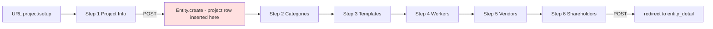

# Plan: Defer project creation in the setup wizard + add a Summary step with a Create button

## Status
- **Phase:** Plan / spec for review. No code edited yet.
- **Locked decisions (from user):**
  1. The setup wizard becomes **create-only**. The `entity_pk` edit/continue shape and its route
     are removed from the wizard (editing an existing project stays out of the wizard).
  2. The Summary **Create Project** action runs **sequentially through every step's data inside one
     `transaction.atomic()` block**. If any stage fails: nothing is created (full rollback), the
     user is **redirected to the step whose data failed**, and an error message is shown. The
     session draft is preserved on failure and cleared only on success.
- **Rule check:** Per `.roo/rules/updatelogics.md` we search `specs/` first — **no `specs/`
  directory exists** in this repo, and no doc describes this wizard (`docs/`, `CHANGES.md`,
  `TODO.md` searched). The behavior below is therefore established from the code itself.

## 1. Current behavior (what we are changing)

The project setup wizard is the **project-creation** flow. Its only user-facing entry point is the
"New Project" link in [`entity_list.html`](apps/app_entity/templates/app_entity/entity_list.html:19)
→ `project/setup/` (`project_create`). It is a 6-step flow that **persists to the database at every
step**; there is no review/summary step and no explicit "Create" action.

1. Step 1 renders the project-info form. On POST,
   [`_handle_step_1_post()`](apps/app_entity/views/project_setup_wizard.py:188) calls
   [`_apply_step1_post()`](apps/app_entity/views/project_setup_wizard.py:135) which immediately runs
   `Entity.create(...)` (line 170) — **the project row is inserted at the end of step 1** — stores
   `wizard_entity_pk` in the session and redirects to step 2 with `entity_pk`.
2. Steps 2–6 then **mutate that already-existing project on every POST**:
   - Step 2 [`_apply_step2_post()`](apps/app_entity/views/project_setup_wizard.py:256) creates /
     activates / deactivates `FinancialCategoriesEntitiesRelations`.
   - Step 3 [`_apply_step3_post()`](apps/app_entity/views/project_setup_wizard.py:360) does
     `entity.product_templates.set(...)` (staff only).
   - Steps 4–6 [`_create_stakeholders()`](apps/app_entity/views/project_setup_wizard.py:540) insert
     `Stakeholder` rows (worker / vendor / shareholder).
3. Step 6 [`_handle_step_6_post()`](apps/app_entity/views/project_setup_wizard.py:454) is treated as
   the "final" step: its POST redirects to `entity_detail` with a "setup completed" message
   (line 520). There is no summary and no separate create action.
4. The same view also exposes an `entity_pk`-based **edit/continue** shape via
   `project/<int:entity_pk>/setup/<int:step>/` (`project_setup_step`). It is **not linked anywhere
   in the UI**; existing-project editing is handled by [`ProjectEditView`](apps/app_entity/views/project_edit.py:18)
   and dedicated per-project views (e.g. [`ProjectProductTemplatesSetupView`](apps/app_inventory/urls.py:44),
   add-vendor/worker/shareholder views, category-relation views). The `entity_pk` wizard shape is
   exercised **only by tests** and is **removed** by this plan (see §3).



Tests encode the current behavior:
- [`test_wizard_step_1_creates_project`](apps/app_entity/tests/test_project_setup_wizard_project_setup_wizard_step1.py:37)
  asserts the `Entity` exists right after the step-1 POST.
- The [`integration test`](apps/app_entity/tests/test_project_setup_wizard_project_setup_wizard_integration.py:50)
  does `Entity.objects.get(...)` after step 1 and then hits `entity_pk`-based URLs for steps 2–6.
- Step 2–6 unit tests create a project directly (`Entity.create` in `setUp`) and POST selections to
  `project/<pk>/setup/<step>/` expecting immediate persistence. All of these are rewritten to the
  create-only session flow.

## 2. Target behavior

- Steps 1–6 **collect data only** and store it in the session (no DB writes).
- A **new step 7 Summary** shows every collected value read-only, with per-section "Edit" links back
  to the relevant step.
- The Summary's **Create Project** button performs the actual creation — applying the steps
  **sequentially inside one atomic transaction**. On any failure nothing is created and the user is
  redirected to the failing step with an error. On success the session is cleared and the view
  redirects to `entity_detail`.

```mermaid
flowchart LR
    A1["URL project/setup"] --> P1["Step 1 Project Info"]
    P1 -->|"store draft in session"| P2["Step 2 Categories"]
    P2 -->|"store draft"| P3["Step 3 Templates"]
    P3 -->|"store draft"| P4["Step 4 Workers"]
    P4 -->|"store draft"| P5["Step 5 Vendors"]
    P5 -->|"store draft"| P6["Step 6 Shareholders"]
    P6 -->|"store draft"| P7["Step 7 Summary + Create button"]
    P7 -->|POST Create| CR["atomic sequential commit"]
    CR -->|success| D["redirect to entity_detail"]
    CR -->|"any stage fails - rollback, draft kept"| FX["redirect to the failing step + error message"]
    style CR fill:#e0ffe0
    style FX fill:#ffe0e0
```



## 3. Scope — wizard is create-only

- The wizard becomes a **create-only** wizard covering steps 1–7. There is no `entity_pk` in the
  URL or the flow.
- **Removed:** the `project_setup_step` route
  (`project/<int:entity_pk>/setup/<int:step>/`) and every code path that accepts an `entity_pk`
  (entity-based context builders, step-1 "edit existing" branch, `wizard_entity_pk` session key).
  The `entity` object is never loaded in the wizard — all context comes from the session draft.
- **Kept:** editing an existing project outside the wizard, via [`ProjectEditView`](apps/app_entity/views/project_edit.py:18)
  and the existing per-project management views (templates, categories, stakeholders). These are out
  of scope and unaffected.
- This removes the dead/test-only `entity_pk` shape and eliminates the two-flow complexity, so the
  view/templates have a single, uniform create path.

## 4. Session draft layout

Reuse the session-wizard convention already used by sale/purchase
([`wizard_base.py`](apps/app_operation/views/create_operation/wizard_base.py:31)), but with a
bespoke key because each step stores a different payload.

Session key: `request.session["project_setup_wizard"]`

```python
{
    "info": {
        "name": str,
        "description": str,
        "is_internal": bool,
        "is_vendor": bool,
        "is_client": bool,
        "active": bool,
    },
    "categories": [category_pk, ...],     # step 2 selection
    "templates":  [template_pk, ...],     # step 3 selection (staff only)
    "workers":    [entity_pk, ...],       # step 4
    "vendors":    [entity_pk, ...],       # step 5
    "shareholders": [entity_pk, ...],     # step 6
}
```

Helpers (module-local, mirroring sale/purchase naming): `_draft_get(request)` (returns `{}`),
`_draft_save(request, data)` (sets key + `request.session.modified = True`),
`_draft_clear(request)`.

**Audit events** (keep the existing `wizard_*` vocabulary):
- per-step stores: `wizard_draft_stepN_saved`
- create success: `wizard_project_created` / `wizard_completed`
- guards: `wizard_draft_missing`, `wizard_summary_create_failed` (with failing step),
  `wizard_summary_redirected_stepN` (on per-stage failure)

## 5. URL changes

[`apps/app_entity/urls.py`](apps/app_entity/urls.py:17)

- Keep `project/setup/` → `project_create` (create-flow step 1, `step=1` default).
- **Add** `project/setup/<int:step>/` → name `project_setup` for create-flow steps 2–7.
- **Remove** `project/<int:entity_pk>/setup/<int:step>/` → `project_setup_step` (create-only).

All Back/Continue/Edit links in templates therefore use only `project_create` / `project_setup`.

## 6. View changes

[`apps/app_entity/views/project_setup_wizard.py`](apps/app_entity/views/project_setup_wizard.py)

The view signature drops the entity dependency: keep `project_setup_wizard_view(request, step=1)`
(no `entity_pk` parameter). Step validity range is `1..7`; `total_steps = 7`; the breadcrumb
"project" badge is not shown (no entity until creation).

### 6.1 POST handlers (draft only — no DB writes)
- `_handle_step_1_post`: validate `name` required → on failure `messages.error("Project name is
  required.")` and stay/re-render step 1. On success **store `info` in the draft**, redirect to
  `project_setup step=2`.
- Steps 2–6: parse the selection list, **store it in the draft** under the step's key, keep the
  existing `Skip` semantics (empty selection → store empty list), redirect to the next create step.
  No DB writes.
- **New `_handle_step_7_post` (Summary / Create):** if draft `info.name` is missing → guard error +
  redirect to step 1 (session-expired guard). Otherwise run the sequential atomic commit (§7).
  On success: `messages.success` "Project created." + redirect to `entity_detail`.
  On failure: rollback guaranteed, `messages.error` with the per-stage message, redirect to the
  failing step; the draft is kept so the user can fix and retry.

### 6.2 GET context (`_get_step_context`) — all from the draft
`_get_step_context(request, step)` reads `_draft_get(request)` and supplies draft-backed context
(some keys reused by the step templates):

- Step 1: `draft_info` fields (`name`, `description`, `is_internal`, `is_vendor`, `is_client`,
  `active`) to prefill the project-info form.
- Step 2: all `FinancialCategory` grouped by aspect (reuse the existing entity-None grouping branch)
  plus `selected_category_ids = draft["categories"]` to pre-check prior choices.
- Step 3: all `ProductTemplate` grouped by nature/sub_category **for staff** plus
  `enabled_ids = draft["templates"]`.
- Steps 4–6: `eligible_entities` per role filter (`_role_filter`) plus
  `existing_stakeholder_ids = draft[role]` so previously selected entities render pre-checked.
- Step 7 (summary): display structure assembled from the draft (§8).
- Always: `step`, `total_steps = 7`, `step_labels`, `step_nums = (1..7)`, `is_create = True`.

The entity-based context helpers (`_step2_context`, `_step3_context`, `_stakeholder_context` with an
entity) are either adapted to draft input or removed; the per-step "already linked/added" sections
that relied on a live entity no longer apply in a fresh create.

## 7. The atomic, sequential Create (Summary commit)

New `_apply_create_project(request)` — a **single** `transaction.atomic()` block that applies each
step's data **sequentially** in its own stage. Each stage is associated with the source step so a
failure can be redirected precisely.

```python
def _apply_create_project(request):
    draft = _draft_get(request)
    failing_step = 1
    with transaction.atomic():
        # Stage A -> step 1 : create the project entity (also validates name)
        entity = Entity.create(entity_type=EntityType.PROJECT, name=draft["info"]["name"], ...)
        # Stage B -> step 2 : categories
        _link_categories(entity, draft["categories"])        # on error: failing_step = 2; raise
        # Stage C -> step 3 : templates (staff only)
        _assign_templates(entity, draft["templates"])        # on error: failing_step = 3; raise
        # Stage D -> steps 4/5/6 : stakeholders, one role each
        _create_stakeholders(entity, "worker", draft["workers"])       # failing_step = 4
        _create_stakeholders(entity, "vendor", draft["vendors"])       # failing_step = 5
        _create_stakeholders(entity, "shareholder", draft["shareholders"])  # failing_step = 6
        # any exception propagates -> full rollback, no project row survives
    return entity
```

Sequential ordering rationale: the project `Entity` must exist before any relation row can reference
it, and the stages run in the wizard's step order so a failure message maps naturally to the step the
user last edited.

Stage implementations reuse existing helpers/logic:
- **Stage B** — same as [`_apply_step2_post()`](apps/app_entity/views/project_setup_wizard.py:256):
  for each selected category `FinancialCategoriesEntitiesRelations.get_or_create(entity, category,
  defaults={"is_active": True, "max_limit": Decimal("0.00")})`; unknown categories are treated as a
  stage-2 failure.
- **Stage C** — `entity.product_templates.set(selected)`; skipped entirely for non-staff.
- **Stage D** — [`_create_stakeholders()`](apps/app_entity/views/project_setup_wizard.py:540) per
  role (worker/vendor/shareholder); a role whose selected ids are all ineligible is not an error
  (silent-skip semantics preserved).

**Failure handling (create-only, atomic):**
- A per-stage `_StageError(step, message)` (or per-stage try/except that records the step and
  re-raises) causes the outer `transaction.atomic()` to roll back — **no project is created**.
- The view catches it, logs + audits (`wizard_summary_create_failed`, failing step), sets
  `messages.error(message)`, and **redirects to the failing step** (`project_setup step=<n>`).
- The draft is preserved on failure so the user's other selections are not lost; it is cleared only
  after a successful commit.

Conventions respected: no new relationships/fields (nothing for the PROTECT / on_delete rule); no
`delete()` calls anywhere; `Entity.save()`'s automatic financial-period side effects roll back with
the transaction on failure.

## 8. Template changes

### 8.1 Container
[`apps/app_entity/templates/app_entity/project_setup_wizard.html`](apps/app_entity/templates/app_entity/project_setup_wizard.html)

- Render `step_7_summary.html` for step 7.
- `total_steps = 7` and `step_nums = (1..7)` — fixed (no entity mode anymore).
- No project badge/breadcrumb (there is no entity until creation).
- Navigation is uniform (all create flow):
  - Back from step N → `project_setup step=N-1` (step 1 shows Cancel → `entity_list`, which also
    clears the draft).
  - Steps 1–6 Continue → next `project_setup` step.
  - Step 7 shows the **Create Project** submit (form POST to the summary URL).
- Forms POST to the current page URL (they already do), so the step is taken from the URL.

### 8.2 Step templates (`app_entity/setup/`)
Small, additive changes so saved selections render pre-checked/prefilled from the draft:
- `step_1_project.html`: prefill fields from `draft` context.
- `step_2_categories.html`: mark available-category checkboxes `checked` when
  `cat.id in selected_category_ids`.
- `step_3_templates.html`: keep staff gate; mark `checked` from `enabled_ids` (already reads it).
- `step_4/5/6_*.html`: mark `checked` when id is in `existing_stakeholder_ids` (already reads it) —
  context is now populated from the draft.

### 8.3 New summary template
`apps/app_entity/templates/app_entity/setup/step_7_summary.html`:
- Read-only sections: project identity (name, description, role flags, active), selected categories
  (grouped by aspect, count), selected templates (count/names), and each stakeholder role
  (count/names) — each with an "Edit" link back to its owning step.
- Empty-state copy when a section has no selections.
- Footer actions: **Create Project** (primary submit on `wizard-form`), **Back to step 6**,
  Cancel → `entity_list` (draft cleared).
- All new copy wrapped in ``; Arabic `.po` translation pass is a follow-up (see §10).

## 9. Edge cases & guards (create-only)

- **Direct load / stale session:** reaching steps 2–7 with no draft → `messages.error` "Session
  expired. Please start from the beginning." and redirect to step 1 (same style as the sale wizard).
- **Skip** remains: POST with empty selection stores empty list and advances.
- **Step 3 staff gate** stays: non-staff sees the limited-access panel and skips; Stage C also skips
  template assignment for non-staff.
- **Name empty at Create:** guarded at step 1 AND re-checked before Stage A.
- **Atomic failure → redirect to the failing step** with the draft preserved; nothing is created.
- **Cancel:** `entity_list` link clears the draft so no stale partial config lingers.
- **Back/forward navigation** never writes to the DB — only the Summary Create commits.

## 10. Localization & repo-convention notes
- Keep user-facing strings in `gettext` / ``. A follow-up `makemessages` / `.po` pass for
  `locale/ar` is expected after implementation (not run here).
- After implementation, update `CHANGES.md` per `.roo/rules/changelog_version_sync.md` and the repo
  version file.

## 11. Resolved decisions (locked)
1. **Create-only wizard:** the `entity_pk` wizard shape and its `project_setup_step` route are
   removed. No edit/continue through the wizard. Existing-project editing outside the wizard stays.
2. **Summary contents:** read-only sections for identity, categories, templates, workers, vendors,
   shareholders with per-section Edit links back to each step.
3. **Create action:** lives on step 7; applies steps sequentially in one `transaction.atomic()`.
   On any failure: no create (rollback), redirect to the failing step with an error message, draft
   preserved; session cleared only on success.

## 12. Test plan (after implementation, per repo rules)

Use Django's runner and capture output under `tmp/` (then delete the temp file):
- `manage.py check`
- Targeted: `manage.py test apps.app_entity.tests.test_project_setup_wizard_project_setup_wizard_step1`
  and `..._integration`.
- Full area run: `manage.py test --parallel=10 apps.app_entity` then reuse with `--keepdb`.

Test rewrites/additions (create-only):
- **Step 1:** GET renders; POST stores `info` in session and **does NOT create an `Entity`**
  (`Entity.objects.count()` unchanged); empty name shows error and stays on step 1; the old
  "edit existing project via wizard" test is **removed**.
- **Steps 2–6:** rewritten to exercise the session flow — POST stores the selection in the draft,
  redirects to the next `project_setup` step, and asserts **no DB rows are created** for categories,
  templates or stakeholders at any point. (Current entity_pk-based unit tests are replaced.)
- **Step 7 / Create:** summary GET lists all draft selections; POST Create with no/empty draft
  redirects to step 1; POST Create with missing name redirects to step 1 with an error; a forced
  per-stage failure (e.g. invalid category) leaves `Entity`/relations **absent** (rollback) and
  redirects to the failing step with an error and the draft intact; successful Create produces the
  project + categories + templates + stakeholders in one go and clears the session draft.
- **Integration:** walk steps 1–6 storing selections, assert no DB rows yet, render step 7, POST
  Create, then assert everything exists and the session draft is gone.

## 13. Files touched (implementation checklist)
- `apps/app_entity/views/project_setup_wizard.py` — create-only rework: 7-step STEPS, draft
  helpers, session step handlers, sequential atomic `_apply_create_project` with per-stage failures,
  summary context.
- `apps/app_entity/urls.py` — add `project/setup/<int:step>/`; remove `project_setup_step`.
- `apps/app_entity/templates/app_entity/project_setup_wizard.html` — 7 steps, create-only nav,
  summary include, Create label, no entity badge.
- `apps/app_entity/templates/app_entity/setup/step_1_project.html` … `step_6_shareholders.html` —
  prefill/checked state from the draft.
- `apps/app_entity/templates/app_entity/setup/step_7_summary.html` — new.
- `apps/app_entity/tests/test_project_setup_wizard_project_setup_wizard_step1.py` … `_step6.py`,
  `..._integration.py` — rewritten for the create-only session flow.
- `CHANGES.md` + version file after code lands.

## 14. Implementation status (post-implementation notes)

Implemented on 2026-09-04 per the locked decisions:

- [`apps/app_entity/views/project_setup_wizard.py`](apps/app_entity/views/project_setup_wizard.py) —
  rewritten as a **create-only** wizard. Steps 1–6 store into the session draft
  (`request.session["project_setup_wizard"]`); no DB writes. Step 7 renders a
  read-only Summary. `_apply_create_project()` runs the stages sequentially inside
  one `transaction.atomic()` (project → categories → templates → workers →
  vendors → shareholders) and raises `_WizardStageError(step, message)` per stage;
  the view catches it and redirects to the failing step with the draft preserved.
  Draft cleared only on success. `project_setup_cancel_view()` clears the draft.
  Removed: entity loading, `_project_not_found`, `wizard_entity_pk`, entity-based
  context builders and all `project_setup_step` redirects.
- [`apps/app_entity/urls.py`](apps/app_entity/urls.py) — added
  `project/setup/<int:step>/` (`project_setup`) and `project/setup/cancel/`
  (`project_setup_cancel`); removed `project/<int:entity_pk>/setup/<int:step>/`
  (`project_setup_step`).
- Templates — container rewritten for 7 steps + create-only nav (Back via
  `project_setup`, Cancel via `project_setup_cancel`, final button "Create
  Project"); step templates read the draft; new `setup/step_7_summary.html`.
- Tests — the seven wizard test modules were rewritten for the create-only session
  flow (including rollback → redirect-to-failing-step cases). 24 targeted tests
  pass; the full `apps.app_entity` suite is green except one pre-existing, unrelated
  failure in `test_entity_forms_person_create_view.py` (an uncommitted edit that
  posts `active=on` while asserting an inactive person — not introduced here).
- `manage.py check` passes; `CHANGES.md` + `VERSION` (1.2.11) updated.
