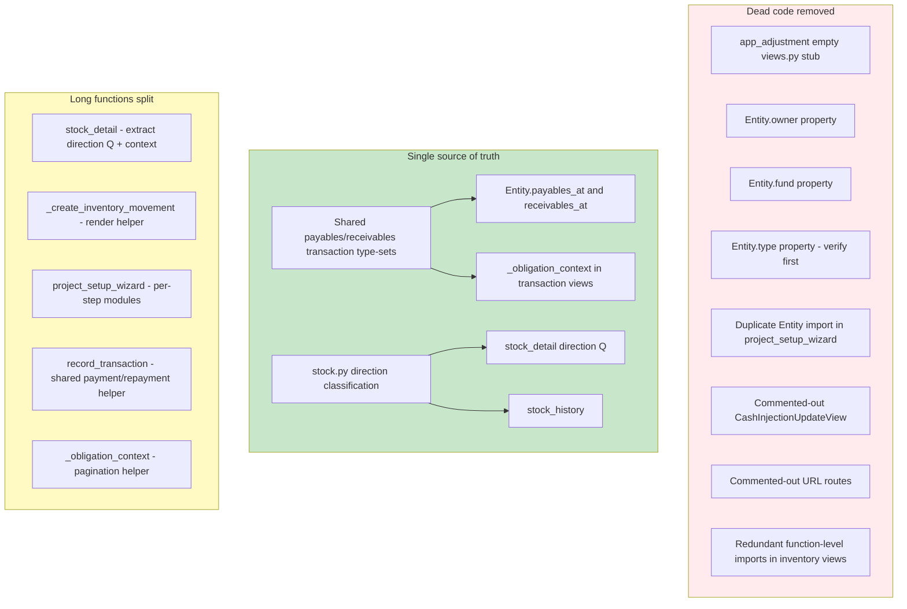

# Plan: Refactor — Remove Dead Code, Reuse Methods, Split Long Functions

## Objective

A pure refactor pass over the current codebase with these goals (from the user):

1. Remove dead codes.
2. Split long functions into logical, abstract units.
3. Improve readability.
4. Remove remaining logic from the views.
5. Reuse other methods' output (single source of truth).
6. No regression — behavior, rendered context, messages, redirects, and audit/debug
   calls must be preserved.

**This is a pure refactor**: no schema/migration changes, no spec edits. All existing
tests must keep passing. The intended behavior is already described in
`docs/specs/` and must be preserved untouched.

---

## Context — What is ALREADY done (do NOT redo)

The previous plan [`ai-plans/view-logic-refactor-plan.md`](ai-plans/view-logic-refactor-plan.md)
was fully implemented on 2026-09-01 and moved most view logic into models/helpers:

- `Operation.settlement_summary()` / `payment_balance()`, `Operation.create()`,
  `PurchaseOperation`/`SaleOperation.create_from_session()` — on the model.
- Shared [`apps/app_transaction/running_balance.py`](apps/app_transaction/running_balance.py),
  [`apps/app_base/navigation.py`](apps/app_base/navigation.py) (`set_entity_navigation`),
  [`apps/app_base/reversal.py`](apps/app_base/reversal.py) (`reversal_guard_error`).
- Shared wizard base [`wizard_base.py`](apps/app_operation/views/create_operation/wizard_base.py);
  purchase/sale wizards are now thin config + direction-specific guards.
- Inventory factories `InventoryMovementLine.create_for_operation()`,
  `InvoiceItem.create_movements()`, `CapitalValuationOperation.create_with_valuation()`,
  `InvoiceItemAdjustment.create_from_item_changes()`.
- Direction helpers [`apps/app_inventory/stock.py`](apps/app_inventory/stock.py)
  (`line_direction`, `history_direction_q`, `active_lines_for_item`).

The remaining work below is additive on top of that foundation.

---

## Target Architecture

---

## Phase 0 — Remove dead code

All items verified during analysis. Each removal must be followed by a quick
grep to confirm no remaining references, then the targeted test run.

### 0a. Delete the empty views stub
[`apps/app_adjustment/views.py`](apps/app_adjustment/views.py:1) contains only
`from django.shortcuts import render` and a comment. It is not imported anywhere
and `app_adjustment` has no `urls.py`. **Action:** delete the file.

### 0b. `Entity.owner` property
[`apps/app_entity/models/__init__.py:276`](apps/app_entity/models/__init__.py:276)
is marked `# TODO remove` and just `return self`. Its only consumer is
`apps/app_entity/templates/app_entity/entity_detail.html:50`:
`{{ entity.owner.description|default:'No description provided.' }}`.
**Action:** change the template to `{{ entity.description|default:'No description provided.' }}`
and remove the property. Rendered output is identical.

### 0c. `Entity.fund` property — KEPT (NOT dead code)
[`apps/app_entity/models/__init__.py`](apps/app_entity/models/__init__.py) exposes
`fund` returning `self`. It is **not** dead: operation proxies use it as a
sentinel via `hasattr(self.source, "fund")` to detect fund-backed entities (e.g.
[`WorkerAdvanceOperation.clean()`](apps/app_operation/models/proxies/op_worker_advance.py:73)).
It was initially misidentified as dead (the `# TODO remove` comment is
misleading); the comment was corrected and the property kept.

### 0d. `Entity.type` property
[`apps/app_entity/models/__init__.py:281`](apps/app_entity/models/__init__.py:281)
returns `self.entity_type`. No production usages found; **but** dynamic/template
use is possible. **Action:** grep `\.type\b` across `templates/` and `apps/`
one more time during implementation; remove only if confirmed unused, otherwise
leave with a note.

### 0e. Duplicate import in project setup wizard
[`apps/app_entity/views/project_setup_wizard.py:15`](apps/app_entity/views/project_setup_wizard.py:15)
re-imports `Entity` already imported at line 10. **Action:** remove the second import.

### 0f. Commented-out code blocks
- [`apps/app_operation/views/edit.py:101`](apps/app_operation/views/edit.py:101) —
  commented-out `CashInjectionUpdateView` class. Remove.
- [`apps/app_operation/urls.py:40`](apps/app_operation/urls.py:40) — commented-out
  `evaluation_create_view_no_product` route (the TODO at line 31 documents the
  unimplemented spec route; keep the TODO comment, remove the dead route block).
- [`apps/app_operation/urls.py:55`](apps/app_operation/urls.py:55) — commented-out
  `purchase_create_view` route. Remove.

### 0g. Redundant function-level imports
[`apps/app_inventory/views.py`](apps/app_inventory/views.py:26) — several functions
re-import names that are already imported at module level (lines 1–22):
- `stock_detail`: `Entity` (line 32), `Product` (line 33).
- `stock_history`: `parse_date` (line 178), `Entity` (line 180), `InventoryMovementLine` (line 181).
- `quick_consume`: `Entity` (line 305), `Product` (line 306).

Also normalize the `today_date` module import (line 3) vs the local
`from datetime import date` shadowing inside functions.

**Action:** remove only the redundant re-imports; keep genuine lazy imports
(`Paginator`, `Case/When/Q`, `stock.py` helpers, `OperationType`, model proxies,
period guard helpers) which are intentionally local.

---

## Phase 1 — Single source of truth for obligation type-sets

The payables/receivables "increase/decrease source/target" transaction-type lists
are **byte-for-byte duplicated** in two places:

- [`Entity.payables_at()`](apps/app_entity/models/__init__.py:479) /
  [`Entity.receivables_at()`](apps/app_entity/models/__init__.py:512)
- [`_obligation_context`](apps/app_transaction/views.py:189)

If the two ever drift, the obligation page totals and the entity summary would
disagree. **Action:** introduce a shared module, e.g.
`apps/app_transaction/obligations.py`, defining:

- `PAYABLES_INCREASE_SOURCE`, `PAYABLES_DECREASE_SOURCE`,
  `PAYABLES_INCREASE_TARGET`, `PAYABLES_DECREASE_TARGET`
- `RECEIVABLES_INCREASE_SOURCE`, `RECEIVABLES_DECREASE_SOURCE`,
  `RECEIVABLES_INCREASE_TARGET`, `RECEIVABLES_DECREASE_TARGET`

Consume the constants from both `Entity.payables_at()` / `receivables_at()` and
`_obligation_context`. Behavior unchanged; removes ~50 duplicated lines and the
drift risk. This directly satisfies "reuse other methods output".

---

## Phase 2 — Move stock_detail direction classification into stock.py

[`stock_detail`](apps/app_inventory/views.py:64) still builds `received_on_sale`,
`active_lines`, `incoming_q`, `outgoing_q` inline with ORM `Q` objects, while
[`stock.py`](apps/app_inventory/stock.py) already owns direction semantics
(`line_direction`, `history_direction_q`). **Action:** add a `portfolio_direction_q(direction)`
helper to `stock.py` (returning the same `Q` semantics used today) and have
`stock_detail` consume it. One source of truth for "what counts as inbound vs
outbound per ownership side"; `stock_history` already reuses the same helpers.

---

## Phase 3 — Split long functions

### 3a. `stock_detail` ([`apps/app_inventory/views.py:25`](apps/app_inventory/views.py:25), ~146 lines)
After Phase 2 removes the direction-Q block, extract:
- `_portfolio_rows(entity, products_qs, portfolio_by_product)` — builds the
  `physically_present_products` list (the per-product card dicts).
- `_paginate(request, qs)` — the repeated `Paginator`/`page_obj` block.

### 3b. `_create_inventory_movement` ([`apps/app_inventory/views.py:635`](apps/app_inventory/views.py:635), ~125 lines)
The error-render block (lines 726–743) is nearly identical to the GET render
(745–759). **Action:** extract `_render_movement_form(request, operation,
formset, invoice_items_json)` and call it from both paths.

### 3c. `record_transaction_payment` / `record_transaction_repayment`
([`apps/app_operation/views/record_transaction.py`](apps/app_operation/views/record_transaction.py:17))
Near-identical: form bind, `create_payment_transaction`/`create_repayment_transaction`,
audit block, error handling, and a render with `source_entity`/
`source_balance`/`remaining_balance`. **Action:** extract a shared
`_render_transaction_form(request, operation, form, template, remaining_balance,
source_getter)` helper and a small `_audit_transaction_created(...)` helper.
Keep each view's distinct guards (`amount_remaining_to_settle` vs
`amount_remaining_to_repay`, `can_repay`).

### 3d. `_obligation_context` ([`apps/app_transaction/views.py:169`](apps/app_transaction/views.py:169), ~110 lines)
After Phase 1, extract the pagination block (shared with
`entity_payment_transactions_view`) into `_paginate(request, rows)`.

### 3e. `project_setup_wizard.py` ([`apps/app_entity/views/project_setup_wizard.py`](apps/app_entity/views/project_setup_wizard.py), 873 lines)
Split the six step handlers + generic stakeholder handler into a
`apps/app_entity/views/setup/` package (e.g. `steps_1.py` … `steps_6.py`, or a
single `steps.py`) with the `STEPS` metadata and the shared
`_handle_stakeholder_post` helper. `project_setup_wizard_view` keeps only
dispatch + step routing. Pure move — no logic change.

---

## Phase 4 — (Optional) Remove residual view logic

[`record_accounting_adjustment`](apps/app_operation/views/adjustment.py:146)
constructs `Adjustment(...)` inline (fields from the form). If it improves
readability without churn, add `Adjustment.create_from_form(form, officer)` on
[`apps/app_adjustment/models.py`](apps/app_adjustment/models.py) and delegate.
This is low priority — the view is already mostly form + guard handling.

---

## Verification (no regression)

Per repo rules ([`AGENTS.md`](AGENTS.md), `.roo/rules/testing.md`):

1. `manage.py check` after each phase; `manage.py makemigrations --check` — must
   show **no** changes (pure refactor).
2. Targeted tests per phase:
   - Phase 0: `apps.app_entity.tests.*` (entity detail), `apps.app_inventory.tests.test_views_get_stock_detail_view`, `test_views_get_stock_history_view`.
   - Phase 1: `apps.app_transaction.tests`, `apps.app_entity.tests.test_entity_detail_financial_summary*` (payables/receivables pages + entity summary).
   - Phase 2: `apps.app_inventory.tests.test_stock`, `test_views_get_stock_detail_view`.
   - Phase 3: `apps.app_operation.tests.views.test_views_get_operation_detail_view`, wizard suites, `apps.app_transaction.tests`.
   - Phase 4: `apps.app_adjustment.tests.*`.
3. Full suite: `manage.py test --parallel=10 --keepdb`; capture output to a temp
   file under `tmp/`, inspect, then delete the temp file. Do **not** run
   `ui_tests/` unless explicitly asked.
4. Confirm the deleted dead code has no lingering references (grep for removed
   names before finalizing).

---

## Out of Scope

- No behavior changes, no schema/migration changes, no spec edits.
- No new third-party dependencies.
- Do NOT re-touch the already-refactored paths listed under "Context" unless a
  duplicated block above lives there.
- `Entity.balance_at`, `profit_loss`, `_tx_sum*`, and other heavily-used model
  methods are NOT dead code — leave them.

---

## Implementation Status — 2026-09-01 (Phase 0 COMPLETE)

Phase 0 (dead-code removal) implemented as a pure refactor:

- Deleted the empty [`apps/app_adjustment/views.py`](apps/app_adjustment/views.py)
  stub (never imported or routed).
- Removed `Entity.owner` and `Entity.type` properties; `entity_detail.html` now
  uses `entity.description` (identical output, since `owner` returned `self`).
- **Kept** `Entity.fund` — it is an `hasattr(...)` sentinel used by the operation
  proxies, not dead code; corrected the misleading `# TODO remove` comment.
- Removed the duplicate `Entity` import in
  [`project_setup_wizard.py`](apps/app_entity/views/project_setup_wizard.py).
- Removed commented-out `CashInjectionUpdateView`
  ([`edit.py`](apps/app_operation/views/edit.py)) and the commented-out
  `evaluation_create_view_no_product` / `purchase_create_view` URL routes
  ([`apps/app_operation/urls.py`](apps/app_operation/urls.py)).
- Removed redundant function-level imports in
  [`apps/app_inventory/views.py`](apps/app_inventory/views.py)
  (`Entity`, `Product`, `parse_date`, `InventoryMovementLine`) and normalized the
  `date` / `today_date` naming.

**Verification:** `manage.py check` clean; `makemigrations --check` → no schema
changes; targeted suites green; full app suite (ui_tests excluded)
`--parallel=10 --keepdb` → **1460 tests OK**.
