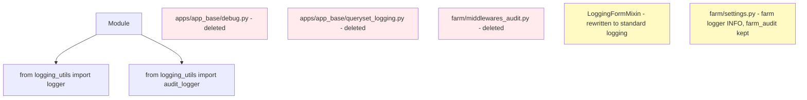

# Plan — Replace Overengineered Debug/Audit Machinery with Standard Python Logging

## Objective

The custom debug & audit layer built around
[`apps/app_base/debug.py`](../apps/app_base/debug.py) is overengineered and noisy
(emojis, indentation depth, per-call timing, JSON data formatting, test-mode
gating, a duplicate file handler, per-view/per-request tracing, and a
request-level audit middleware). Replace it with idiomatic standard-library
logging:

- **One project-wide logger**, `logging.getLogger("farm")`, shared by all modules
  (imported from a small helper module — no per-module loggers).
- Levels map to real severity (`debug`/`info`/`warning`/`error`), and the
  verbose per-step `success`/`section` noise is dropped or demoted to `debug`.
- Keep a **minimal** `farm_audit` logger, routed to `logs/audit.log` via the
  existing `LOGGING` config in [`farm/settings.py`](../farm/settings.py), used
  **only** for compliance events (create/update/delete of key records, reversals,
  period close).
- Delete the custom decorators, the queryset-logging dead code, and the
  request-level audit middleware.

This is a **pure refactor**: no schema/migration changes, no behavior changes to
rendering, redirects, messages, or business logic. The debug/audit calls have no
spec coverage under `docs/specs/` (verified), so no spec edits are required.
All existing tests must keep passing.

## Current State (verified during analysis)

- `apps/app_base/debug.py` (415 lines) defines:
  - `DebugContext` with `section`, `log`, `error`, `warn`, `success`, `audit`,
    `transaction_start`, `transaction_commit`, `transaction_rollback`, plus
    indentation/timing/format helpers and `_in_test_mode()` gating.
  - Decorators: `debug_view` (used ~55 sites), `debug_transaction` (imported but
    never applied), and dead `debug_function`, `debug_model_save`, `debug_signal`,
    `debug_db_operation`.
  - `_configure_audit_handler()` — adds a `FileHandler` to `audit_logger` at
    import time, **duplicating** the `farm_audit` handler already configured in
    `farm/settings.py`.
- `apps/app_base/queryset_logging.py` — `LoggingQuerySet`/`LoggingManager` are
  unused dead code (`LoggingManager` wrongly subclasses `logging.Manager`).
- `apps/app_base/form_logging.py` — `LoggingFormMixin` used by ~15 forms across
  `app_entity`, `app_adjustment`, `app_base`, `app_inventory`, `app_operation`.
- `farm/middlewares_audit.py` — `AuditTrailMiddleware` logs every request/response
  as JSON; registered in `MIDDLEWARE`.
- `farm/settings.py` — `LOGGING` defines `farm_debug`, `farm_audit`, `apps`,
  `django.db.backends` loggers; test-mode block silences `farm_debug`/`farm_audit`.
- ~40 modules import `from apps.app_base.debug import ...` with ~300+ call sites.

## Target Architecture



## API Mapping Table

| Current API | Replacement |
| --- | --- |
| `DebugContext.log(msg, data, level)` | `logger.debug(f"{msg} \| {data}")` (or mapped logging level) |
| `DebugContext.success(msg, data)` | drop, or `logger.debug(...)` when it carries data not in surrounding logs |
| `DebugContext.warn(msg, data)` | `logger.warning(f"{msg} \| {data}")` |
| `DebugContext.error(msg, exc, data)` | `logger.error(f"{msg} \| {data}", exc_info=(exc,) if exc else None)` |
| `with DebugContext.section(title, data):` | remove the `with`, de-indent body one level; keep meaningful inner `logger.debug(...)`; drop title-only noise |
| `DebugContext.audit(action, entity_type, entity_id, details, user)` | `audit_logger.info(f"{action} \| {entity_type}:{entity_id} \| user={user} \| {details}")` |
| `DebugContext.transaction_start(...)` | `audit_logger.info(f"transaction_start ...")` (or `logger.info`) |
| `DebugContext.transaction_commit(...)` | `audit_logger.info(f"transaction_commit ...")` |
| `DebugContext.transaction_rollback(...)` | `audit_logger.error(...)` + `logger.error(..., exc_info=True)` |
| `@debug_view` / `@method_decorator(debug_view)` | remove decorator line and its import |
| `debug_transaction` (unused) | remove import |
| `debug_function/model_save/signal/db_operation` (dead) | removed with `debug.py` |
| `from apps.app_base.debug import DebugContext` | `from apps.app_base.logging_utils import logger` (+ `audit_logger` where audit is needed) |

## Phase 1 — Foundation

1. **Create `apps/app_base/logging_utils.py`**
   ```python
   import logging
   logger = logging.getLogger("farm")          # one project-wide logger
   audit_logger = logging.getLogger("farm_audit")  # compliance-only channel
   ```
   Single shared handle to both loggers so callers never repeat
   `logging.getLogger(...)`. Modules import `from apps.app_base.logging_utils
   import logger` (and `audit_logger` only where audit is needed).

2. **Rewrite `apps/app_base/form_logging.py`**
   - Import `logger` and `audit_logger` from `logging_utils`.
   - `clean()` → `logger.debug(...)` entry; on errors `logger.warning(...)`;
     drop success noise.
   - `save()` → `logger.debug(...)`; on `commit`, `audit_logger.info(f"form_create|update ...")`.
   - Keep the `LoggingFormMixin` class name so the ~15 inheriting forms are untouched.

3. **Update `farm/settings.py`**
   - Remove `AuditTrailMiddleware` from `MIDDLEWARE`.
   - `LOGGING`: remove the `farm_debug` and `apps` logger entries; add a single
     `"farm"` logger → `console` + `debug_file`, `level: INFO` (so `logger.debug`
     stays silent by default, addressing the noise complaint); keep
     `farm_audit` → `audit_file` at `INFO`; keep `django.db.backends` at `INFO`.
   - Test-mode `LOGGING` block: add `"farm"` off (`level: CRITICAL`,
     `propagate: False`), keep `farm_audit` off, keep `django.db.backends` off.

4. **Delete files**
   - `apps/app_base/debug.py`
   - `apps/app_base/queryset_logging.py`
   - `farm/middlewares_audit.py`

## Phase 2 — Migrate model files (5)

- `apps/app_transaction/models.py`
  - Remove `debug_transaction` import; import `logger` (+ `audit_logger`) from
    `logging_utils`.
  - `Transaction.clean()` and `Transaction.create()`: `DebugContext.log/success/error` →
    `logger.debug/info/error`.
  - `Transaction.reverse()`: replace `transaction_start/transaction_commit/
    transaction_rollback` with `audit_logger.info(...)` / `audit_logger.error(...)`;
    replace the `with DebugContext.section(...)` block by de-indenting and
    keeping `logger.debug(...)` lines; keep the `transaction_reversed` audit.
- `apps/app_adjustment/models.py`
  - `clean()`, `save()`, `delete()`, `InvoiceItemAdjustment.finalize()/reverse()`,
    `InvoiceItemAdjustmentLine.save()`: convert per mapping; keep
    `adjustment_{action}` / `adjustment_deleted` audits.
- `apps/app_inventory/models.py`
  - `Product.clean()/save()/delete()`: convert; keep `product_{action}` /
    `product_deleted` audits.
- `apps/app_operation/models/operation.py`
  - `Operation.clean()`, `_validate_invoice_items()`, `save()`, `delete()`,
    `reverse()`: convert; in `reverse()` replace `transaction_start/commit/
    rollback` with audit logging; keep `operation_{created|updated|deleted|
    reversed|reversal_failed}` audits.
- `apps/app_entity/models/__init__.py`
  - `ContactInfo.save/delete`, `Stakeholder.save/delete`, `Entity.clean/save/
    delete`: convert; keep `contact_info_*`, `stakeholder_*`, `entity_*` audits.

## Phase 3 — Migrate forms

- `apps/app_entity/forms.py` — two local `from apps.app_base.debug import
  DebugContext` inside `PersonForm.clean_name` / `ProjectForm.clean_name`:
  use module-level `logger` imported from `logging_utils`; `log/warn/success` →
  `logger.debug/warning/debug`.

## Phase 4 — Migrate views (~28 files)

For every file: drop `from apps.app_base.debug import ...`, import `logger`
(+ `audit_logger`) from `logging_utils`, remove `@debug_view` /
`@method_decorator(debug_view)` decorator lines (and the `method_decorator`
import if it becomes unused), and convert all `DebugContext.*` calls per the
mapping table (sections de-indented).

- `apps/app_report/views.py`
- `apps/app_transaction/views.py`
- `apps/app_inventory/views.py` (4 `@debug_view`, no DebugContext calls)
- `apps/app_operation/views/`: `adjustment.py`, `adjustments_list.py`,
  `detail.py`, `edit.py`, `invoice_items.py`, `list.py`, `period.py`,
  `record_transaction.py`, `reverse.py`
- `apps/app_operation/views/create_operation/`: `base.py`, `create_birth_view.py`,
  `create_death_view.py`, `evaluation.py`, `purchase_wizard.py`, `sale_wizard.py`
  (note: `base.py`/`create_birth_view.py`/`create_death_view.py`/`evaluation.py`
  use `@method_decorator(debug_view)` on `dispatch`; `purchase_wizard.py`/
  `sale_wizard.py` use plain `@debug_view` and have no DebugContext calls)
- `apps/app_entity/views/`: `project_setup_wizard.py`, `project_edit.py`,
  `project_create.py`, `person_edit.py`, `person_create.py`, `entity_list.py`,
  `entity_detail.py`, `edit_stakeholder.py`, `edit_contact_info.py`,
  `add_contact_info.py`, `add_stakeholder.py`, `category/category_relation_edit.py`,
  `category/category_relation_detail.py`, `category/category_bulk_assign.py`

## Phase 5 — Cleanup & Verification

1. Grep whole repo for `app_base.debug`, `DebugContext`, `debug_view`,
   `debug_transaction`, `farm_debug`, `middlewares_audit` — no references remain.
2. `manage.py check`.
3. Run `manage.py test --parallel=10` (capture output to `tmp/`, inspect, delete
   the temp file per repo test rules). If schema unchanged, subsequent runs use
   `--keepdb`.
4. Update `docs/logging/*` (README, LOGGING_STANDARDS,
   LOGGING_IMPLEMENTATION_GUIDE, COMPREHENSIVE_LOGGING_IMPLEMENTATION) and
   `docs/debugging/*` to describe the standard-logging approach and the minimal
   `farm_audit` channel.
5. Commit changes with a descriptive message; keep the git repo synced with any
   follow-up removals.

## Risks / Notes

- **Section de-indentation** is the highest-churn, highest-risk step. Work
  file-by-file and re-run tests after each app group. Use `apply_diff` with
  exact context.
- **Audit scope**: preserve the existing `action` strings for compliance events
  (reversals, period close, create/update/delete) so any downstream consumers of
  `logs/audit.log` keep working; the JSON envelope is replaced by a flat,
  greppable line.
- **Noise default**: with the `farm` logger at `INFO`, the migrated
  `logger.debug` calls are silent in normal operation; developers can raise the
  level to `DEBUG` when tracing is needed — no code changes required.
- Keep `LoggingFormMixin` (it is used); only its internals change.
- **Single logger**: all modules share the `farm` logger via `logging_utils`;
  per-module `logging.getLogger(__name__)` is intentionally not used.

---

## ✅ IMPLEMENTED — 2026-09-01

All phases were completed and verified:

**Foundation**
- Created [`apps/app_base/logging_utils.py`](../apps/app_base/logging_utils.py)
  exposing `logger = logging.getLogger("farm")` and
  `audit_logger = logging.getLogger("farm_audit")`.
- Rewrote [`apps/app_base/form_logging.py`](../apps/app_base/form_logging.py)
  (`LoggingFormMixin`) on standard logging (kept the class name; all ~15 forms
  inherit it unchanged).
- [`farm/settings.py`](../farm/settings.py): removed `AuditTrailMiddleware`
  from `MIDDLEWARE`; `LOGGING` now has a single `"farm"` logger
  (console + `debug_file`, `INFO`), keeps `farm_audit` → `audit_file`, and the
  test-mode block silences `farm`/`farm_audit`/`django.db.backends`.
- Deleted `apps/app_base/debug.py`, `apps/app_base/queryset_logging.py`, and
  `farm/middlewares_audit.py`.

**Call sites migrated (all ~40 modules)**
- 5 model files: `app_transaction/models.py` (incl. `Transaction.reverse()`),
  `app_adjustment/models.py`, `app_inventory/models.py`,
  `app_operation/models/operation.py` (incl. `Operation.reverse()`), and
  `app_entity/models/__init__.py`.
- `apps/app_entity/forms.py` (2 local imports in `clean_name`).
- ~28 view files across `app_report`, `app_transaction`, `app_inventory`,
  `app_operation` (incl. `create_operation/`), and `app_entity` — all
  `@debug_view`/`@method_decorator(debug_view)` decorators removed, all
  `DebugContext.*` calls converted per the mapping table (sections de-indented,
  `warn`→`logger.warning`, `error`→`logger.error`, `audit`→`audit_logger`).

**Cleanup & verification**
- Repo-wide grep: no `app_base.debug`, `DebugContext`, `debug_view`,
  `debug_transaction`, `farm_debug`, `middlewares_audit`, `queryset_logging`
  references remain.
- `manage.py check` → no issues.
- `manage.py test apps --parallel=10 --keepdb` → **1460 tests, OK**.
  (The only failures in a full run are the browser-based `ui_tests.*`, which
  require a live server/browser and are out of scope per repo rules.)

**Docs updated**
- `docs/logging/*` (README, LOGGING_STANDARDS, LOGGING_IMPLEMENTATION_GUIDE,
  COMPREHENSIVE_LOGGING_IMPLEMENTATION) and `docs/debugging/*`
  (DEBUG_README, DEBUG_QUICK_REFERENCE, DEBUG_POINTS_INDEX,
  DEBUG_IMPLEMENTATION_SUMMARY) plus the `docs/guides/PROJECT_WALKTHROUGH.md`
  logging sections now describe the standard-logging approach and the minimal
  `farm_audit` channel; deleted components are documented.
