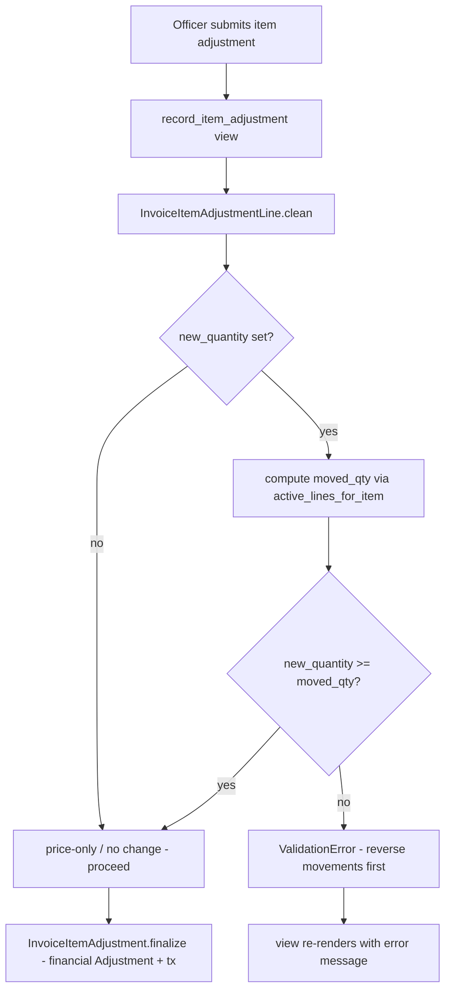

# Plan: Resolve VA3 Divergence — "new qty ≥ already moved" guard for item adjustments

## Status

- **Spec intent:** [`docs/specs/operations/op_14_sale.md`](docs/specs/operations/op_14_sale.md) §5.5.1 (VA3) and [`docs/specs/operations/op_13_purchase.md`](docs/specs/operations/op_13_purchase.md) §5.5.1 (VA3) both require:
  `new_qty ≥ moved_qty` — an officer may not shrink an invoice item below the quantity that has **already been moved** (delivered for SALE, received for PURCHASE).
- **Code reality:** `InvoiceItemAdjustmentLine.clean()` ([`apps/app_adjustment/models.py`](apps/app_adjustment/models.py:727)) only requires ≥ 1 change field + item belongs to the operation. The guard is **NOT enforced** — a **registered divergence** (marked ⚠️ in the specs and in the `clean()` docstring).
- **Task:** Implement the guard (fix the code to match the spec). The user specifically flagged the **sale** case: "the negative sale item adjustment shouldn't exceed the already moved items."

## 1. What "item adjustments are now purely financial" means (answer to user's question)

Before the "Flatten products / Deferred movement" refactor, `InvoiceItemAdjustmentLine.save()` called `_sync_products()`. That method:
- created/deleted **Product** rows to keep physical inventory in lockstep with the contract, and
- **blocked** any quantity decrease while products had movements (this was the old VA3 guard).

After the refactor, **Product rows became purely physical inventory assets, managed exclusively through `InventoryMovementLine`** (movements, reversals). Item adjustments stopped touching products entirely. Today an item adjustment does only two things:

1. **Contract layer** — records the renegotiated quantity/price (`InvoiceItemAdjustment` + `InvoiceItemAdjustmentLine`), which changes `InvoiceItem.adjusted_quantity` / `adjusted_unit_price`.
2. **Financial layer** — records the money delta (`Adjustment` + non-cash `*_ADJUSTMENT` transaction + `effective_amount`).

It no longer creates/deletes product rows, and (because the old guard lived inside `_sync_products()`) it no longer prevents shrinking an item below its already-moved quantity.

**Consequence of that gap:** sold 10, already delivered 8, then shrink the item to 5 → `remaining_qty = 5 − 8 = −3` in `Operation.get_items_data()` ([`apps/app_operation/models/operation.py`](apps/app_operation/models/operation.py:141)) and a ledger that "moved more than the item's adjusted quantity". The contract and the physical record contradict each other.

**Why we can re-add the guard without re-introducing product sync:** VA3 is a *contract* invariant, not a product-sync mechanism. We keep items "purely financial" (no product re-sync) but stop the contract from contradicting physical reality: you cannot say "the client bought only 5" when 8 were already delivered. To legitimately lower the qty, the officer must first **reverse movements** to bring `moved_qty` down, then adjust.

## 2. Root cause

- [`apps/app_adjustment/models.py`](apps/app_adjustment/models.py:727) — `InvoiceItemAdjustmentLine.clean()` lacks the `new_qty ≥ moved_qty` check.
- The pinned tests in [`apps/app_adjustment/tests/test_invoice_item_adjustment_validation.py`](apps/app_adjustment/tests/test_invoice_item_adjustment_validation.py:242) (`DecreaseWithMovementsTest`) explicitly assert the **old (allow)** behavior and document the divergence.

## 3. Solution

### 3.1 Model guard (primary fix)

In `InvoiceItemAdjustmentLine.clean()` ([`apps/app_adjustment/models.py`](apps/app_adjustment/models.py:727)), after the existing checks, add:

```python
from django.db.models import Sum
from apps.app_inventory.stock import active_lines_for_item

if self.new_quantity is not None:
    moved = (
        active_lines_for_item(self.invoice_item).aggregate(total=Sum("quantity"))["total"]
        or Decimal("0")
    )
    if self.new_quantity < moved:
        raise ValidationError(
            _(
                "New quantity (%(new)s) cannot be less than the already-moved "
                "quantity (%(moved)s) for '%(item)s'. Reverse movements first, "
                "then adjust the quantity."
            )
            % {
                "new": self.new_quantity,
                "moved": moved,
                "item": self.invoice_item.product_template.name,
            }
        )
```

- `active_lines_for_item()` ([`apps/app_inventory/stock.py`](apps/app_inventory/stock.py:51)) is the **same helper** `get_items_data()` uses, so the guard's `moved_qty` is exactly the "already moved" figure shown on the operation detail page — no drift.
- Applied to **both PURCHASE and SALE** (the same model serves both; both specs list VA3 identically; the user's sale case is covered).
- The view already calls `line.full_clean()` inside the atomic block ([`apps/app_operation/views/adjustment.py`](apps/app_operation/views/adjustment.py:292)); the `except` block surfaces the message via `messages.error`.
- Remove the now-obsolete "⚠️ REGISTERED DIVERGENCE" docstring comment in `clean()`.

### 3.2 Tests (`DecreaseWithMovementsTest`)

Update [`apps/app_adjustment/tests/test_invoice_item_adjustment_validation.py`](apps/app_adjustment/tests/test_invoice_item_adjustment_validation.py:242):

- Rewrite the class docstring: the guard is now **implemented**.
- Keep allowed cases: `new_qty ≥ moved_qty` (e.g. 10 → 8 with 5 moved), price-only decreases, increases.
- **Add blocking cases:**
  - `test_decrease_below_moved_quantity_raises` — item qty 10, moved 8, `new_quantity=5` → `ValidationError`.
  - `test_decrease_to_moved_quantity_succeeds` — `new_quantity=8` (== moved) → allowed (boundary).
  - `test_sale_decrease_below_moved_quantity_raises` — **SALE-path** variant (source=Client → project), item qty 10, moved 8, `new_quantity=5` → `ValidationError`. (The existing class only covers PURCHASE.)
- Update the movement simulation helper if needed so `moved_qty` is deterministic.

### 3.3 Spec edits (resolve the divergence)

Per project rule ("search the specs first; provide spec edits first"):

- [`docs/specs/operations/op_14_sale.md`](docs/specs/operations/op_14_sale.md:307) §5.5.1 VA3 row:
  - Enforced by → `InvoiceItemAdjustmentLine.clean()`
  - Remove `⚠️ NOT IMPLEMENTED`
  - Pinned by test → the new blocking tests (e.g. `DecreaseWithMovementsTest.test_decrease_below_moved_quantity_raises` · `test_sale_decrease_below_moved_quantity_raises`)
  - Replace the "Registered divergence" blockquote with a short note that the guard is implemented (items remain financial-only; product re-sync stays removed).
- [`docs/specs/operations/op_13_purchase.md`](docs/specs/operations/op_13_purchase.md:296) §5.5.1 VA3 row: update pinned test + remove "allowed — see note in Sale spec".
- [`docs/specs/operations/op_14_sale.md`](docs/specs/operations/op_14_sale.md:418) §9 branch catalog: drop the `⚠️ NOT IMPLEMENTED` marker.
- [`docs/specs/operations/operations-comparison.md`](docs/specs/operations/operations-comparison.md:200) already lists VA3 as intended — no change.

### 3.4 Optional UX (recommended)

- [`apps/app_operation/views/adjustment.py`](apps/app_operation/views/adjustment.py:135) `record_item_adjustment`: compute per-item `moved_qty` (same helper) and pass it to the template (GET + error contexts).
- [`apps/app_adjustment/templates/app_adjustment/record_item_adjustment.html`](apps/app_adjustment/templates/app_adjustment/record_item_adjustment.html:36): show "Already Moved" next to Current Qty and set the New Qty input `min` to `moved_qty` (client-side hint; the model guard remains authoritative).

## 4. Data-flow after change



## 5. Files to modify

| # | File | Change |
|---|------|--------|
| 1 | [`apps/app_adjustment/models.py`](apps/app_adjustment/models.py:727) | Add VA3 guard in `InvoiceItemAdjustmentLine.clean()`; remove divergence comment |
| 2 | [`apps/app_adjustment/tests/test_invoice_item_adjustment_validation.py`](apps/app_adjustment/tests/test_invoice_item_adjustment_validation.py:242) | Update `DecreaseWithMovementsTest` + add blocking/boundary/SALE tests |
| 3 | [`docs/specs/operations/op_14_sale.md`](docs/specs/operations/op_14_sale.md:307) | VA3 row + divergence note + §9 catalog |
| 4 | [`docs/specs/operations/op_13_purchase.md`](docs/specs/operations/op_13_purchase.md:296) | VA3 row pinned test |
| 5 | [`apps/app_operation/views/adjustment.py`](apps/app_operation/views/adjustment.py:135) | Pass per-item `moved_qty` to template (UX) |
| 6 | [`apps/app_adjustment/templates/app_adjustment/record_item_adjustment.html`](apps/app_adjustment/templates/app_adjustment/record_item_adjustment.html:36) | Show "Already Moved"; floor New Qty input (UX) |

## 6. Verification

- Target tests first:
  - `manage.py test app_adjustment.tests.test_invoice_item_adjustment_validation --parallel=10 --keepdb`
  - `manage.py test app_operation --parallel=10 --keepdb`
  - `manage.py test app_inventory --parallel=10 --keepdb` (movement interplay)
- Capture full output to `tmp/` (repo root), inspect, then delete the temp file (do not delete `tmp/`).
- `manage.py check`
- Optional audit: query `Operation.get_items_data()` across existing SALE/PURCHASE items to detect pre-existing negative `remaining_qty` (report only; the guard prevents new ones).

## 7. Notes / decision points

- **Scope both ops:** the guard is implemented for PURCHASE **and** SALE (identical VA3 in both specs; same model). If the user wants SALE-only, restrict the check to `operation.operation_type == SALE`.
- Historical bad rows are not auto-fixed by this change; an audit/cleanup step can be added separately if desired.
- After implementation: update this plan file with what was actually done, then commit.

---

## 8. Implementation log

Implemented 2026-09-01 (Code mode):

- **Model guard (VA3):** [`apps/app_adjustment/models.py`](apps/app_adjustment/models.py:727) —
  `InvoiceItemAdjustmentLine.clean()` now rejects `new_quantity < moved_qty`, where `moved_qty` is the
  sum of active movement lines via `active_lines_for_item()` (the same helper `Operation.get_items_data`
  uses). Applies to PURCHASE and SALE. The old "REGISTERED DIVERGENCE" docstring was replaced.
- **Tests:** [`apps/app_adjustment/tests/test_invoice_item_adjustment_validation.py`](apps/app_adjustment/tests/test_invoice_item_adjustment_validation.py:242) —
  `DecreaseWithMovementsTest` docstring updated; added `test_decrease_below_moved_quantity_raises`,
  `test_decrease_to_moved_quantity_succeeds`, and `test_sale_decrease_below_moved_quantity_raises`
  (SALE-path; the product is assigned to the selling project to satisfy `InventoryMovementLine.clean()`
  ownership). Kept the allowed price-only / increase / `new_qty >= moved` cases.
- **Specs:** [`docs/specs/operations/op_14_sale.md`](docs/specs/operations/op_14_sale.md:307) VA3 row marked
  implemented (divergence note replaced, §9 catalog updated);
  [`docs/specs/operations/op_13_purchase.md`](docs/specs/operations/op_13_purchase.md:296) VA3 pinned test
  updated.
- **UX:** [`apps/app_operation/views/adjustment.py`](apps/app_operation/views/adjustment.py:159) attaches
  `item.moved_qty` to each item; [`record_item_adjustment.html`](apps/app_adjustment/templates/app_adjustment/record_item_adjustment.html:31)
  shows "Moved: N" and floors the New Qty input at `moved_qty`.
- **Verification:** `apps.app_adjustment` + `apps.app_operation` + `apps.app_inventory` = 1262 tests, all
  OK (`manage.py test --parallel=10 --keepdb`).
