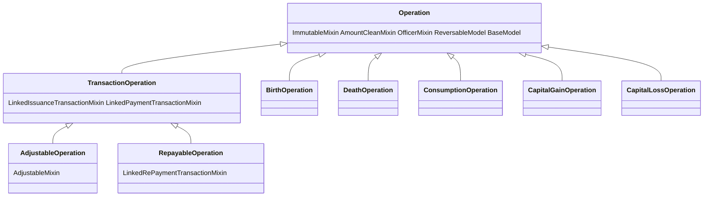

# Plan — Strip the accounting/transaction mixins from the non-accounting stock operations (middle ground v3)

**Status:** Proposed (awaiting approval). REVISION 3 — replaces the rejected StockEvent
extraction plan and the earlier mixin-only v2.
**Date:** 2026-08-14
**Scope:** `apps/app_operation/models/operation.py`, `apps/app_operation/models/proxies/*`,
`apps/app_operation/views/{list,detail,adjustment}.py`, `apps/app_operation/validators.py` (n/a),
detail/list templates, `apps/app_entity/models/__init__.py` (`profit_loss`),
`apps/app_transaction/transaction_type.py` (optional cleanup), specs, tests.

---

## 1. Direction (confirmed with user)

The user rejected the invasive StockEvent extraction and asked for a middle ground:

> Let these operations as they are, but don't inherit the unused / unnecessary mixins.
> Analyse: the following mixins are unnecessary — LinkedIssuance, LinkedPayment,
> LinkedRepaym, Adjustable. Some of them are used but unnecessary.

So: keep Birth / Death / Consumption / Capital Gain / Capital Loss as `Operation` rows
(no new model, no parallel tables, no view moves, no data migration), keep **all** their
inventory behaviour and guards, but remove the 4 accounting/transaction mixins so they
stop creating transactions and stop carrying settlement/repayment/adjustment machinery.

---

## 2. Spec analysis — current accounting behaviour is "used but unnecessary"

Per the repo rule, the specs document the current behaviour as intended ([`op_17_birth.md`](../docs/specs/operations/op_17_birth.md),
[`op_18_death.md`](../docs/specs/operations/op_18_death.md),
[`op_19_consumption.md`](../docs/specs/operations/op_19_consumption.md),
[`op_5_capital_gain.md`](../docs/specs/operations/op_5_capital_gain.md),
[`op_6_capital_loss.md`](../docs/specs/operations/op_6_capital_loss.md)):

- SC1: issuance tx created on save · SC2: non-cash payment tx created on save · SC5:
  settled immediately · SR4/SR5: counter-txs on reversal · VC11/SC13: period assigned.

These are **non-cash bookkeeping** records (their `*_PAYMENT` types are already excluded
from `payment_types()`). They carry **no real accounting value** — the operations' true
effect is inventory (auto movements, product status, capital value). The mixins are
therefore **unnecessary** for these 5 operations even though they are currently exercised.

---

## 3. Mixin analysis for the 5 operations

| Mixin | Currently used? | Verdict for the 5 |
|---|---|---|
| `LinkedIssuanceTransactionMixin` | ✅ creates `*_ISSUANCE` tx (SC1) | **Unnecessary** — remove: stop creating issuance txs; drop `_issuance_transaction_type`, `payment_source_fund`, `payment_target_fund`, SourceFund/TargetFund active checks (VC5/VC6) |
| `LinkedPaymentTransactionMixin` | ✅ creates one-shot `*_PAYMENT` tx + settlement (SC2/SC5) | **Unnecessary** — remove: stop creating payment txs; drop `amount_settled`/`is_fully_settled`/`amount_remaining_to_settle` on these ops |
| `LinkedRePaymentTransactionMixin` | ❌ never (no repayment) | **Unused** — remove |
| `AdjustableMixin` | ⚠️ only `effective_amount` read by shared views/templates (ops are `is_adjustable=False`) | **Unnecessary** — remove; guard `effective_amount` call sites (falls back to `amount`) |
| `ImmutableMixin` | ✅ | keep (spec IM1–IM3) |
| `AmountCleanMixin` | ✅ | keep (spec VC7) |
| `OfficerMixin` | ✅ | keep (officer staff/active) |
| `ReversableModel` / `HasRelatedTransactions` | ✅ | keep (reversal still reverses movement lines + clones; with no txs, no counter-txs) |
| `BaseModel` | ✅ | keep |

**Effect of removal (intended):** these operations no longer create `Transaction` rows, no
longer affect `Entity.profit_loss()`, and no longer show payment/settlement UI. Their
financial footprint flows through **inventory value** (`stock.inventory_value()` →
`FinancialPeriod.end_assets`), exactly as the user requested earlier.

---

## 4. Base-class restructure (`apps/app_operation/models/operation.py`)

To make the 5 operations *not inherit* the 4 mixins (currently on the shared `Operation`
base), split the hierarchy:

- **`Operation`** (lean base): keep `ImmutableMixin, AmountCleanMixin, OfficerMixin,
  ReversableModel, BaseModel` + all fields and shared methods (`create`,
  `resolve_request`, `clean`, `save` incl. period assignment + closed-period guard,
  `save_inventory`, `_auto_create_inventory_movements`, `get_items_data`, `reverse`,
  inventory owner/receiving helpers, config attrs).
  Remove `LinkedIssuanceTransactionMixin, LinkedPaymentTransactionMixin,
  LinkedRePaymentTransactionMixin, AdjustableMixin` from the MRO.
- **`TransactionOperation(LinkedIssuanceTransactionMixin, LinkedPaymentTransactionMixin,
  Operation)`** — for all operations that still create transactions.
- **`AdjustableOperation(AdjustableMixin, TransactionOperation)`**.
- **`RepayableOperation(LinkedRePaymentTransactionMixin, TransactionOperation)`**.

### 4.1 Rebase each proxy

| Proxy | New parent |
|---|---|
| Birth, Death, Consumption, CapitalGain, CapitalLoss | `Operation` |
| CashInjection, CashWithdrawal, ProjectFunding, ProjectRefund, InternalTransfer, CorrectionCredit, CorrectionDebit | `TransactionOperation` |
| Purchase, Sale, Expense | `AdjustableOperation` |
| Loan, WorkerAdvance | `RepayableOperation` |

No MRO change needed for the mixins' own `save()` overrides: `TransactionOperation.save()`
still chains through `Operation.save()`.

---

## 5. Proxy cleanup (the 5 operations)

For each of the 5 proxies, remove (they are only consumed by the removed mixins):
- `_issuance_transaction_type`, `_payment_transaction_type`
- `payment_source_fund`, `payment_target_fund` properties
- `_is_one_shot_operation`, `max_payment_transaction_count` (and the
  `from apps.app_transaction.transaction_type import TransactionType` import)

Keep (still used by `resolve_request()` / `Operation.create()` / views / guards):
- `url_str`, `label`, `_source_role`, `_dest_role`, `theme_color`, `theme_icon`
- `can_pay=False`, `is_partially_payable=False`, `has_category=False`,
  `category_required=False`, `has_repayment=False`
- `has_invoice=True`, `creates_assets` (BIRTH=True), `clean_source`/`clean_destination`
  (entity-role guards), `project` property where present.
- **Financial period behaviour — explicit user requirement:** the 5 operations keep
  `period` auto-assignment and the **closed-period guard**. Both live in base
  `Operation.save()` / `Operation.clean()` (NOT in any removed mixin), and `period_entity`
  resolves from `_source_role` / `_dest_role` (kept). So VC10 (closed period), VC11
  (covering period exists) and SC13 (period assigned) continue to apply to the 5.

---

## 6. Guard shared views + templates (mixin-absent ops)

These ops no longer expose `effective_amount`, `amount_settled`, `is_fully_settled`,
`amount_remaining_to_settle`, `payment_transactions`, `repayment_transactions`,
`is_overpayed_settled`, `is_overpaid_repayed`, `repayable_amount`, `amount_repayed`.
Guard every shared call site:

- [`views/list.py`](../apps/app_operation/views/list.py:60) — `effective_amount`,
  `amount_settled`, `is_fully_settled` → `getattr(op, "…", fallback)`; the 5 render as
  `one_shot`, paid == amount.
- [`views/detail.py`](../apps/app_operation/views/detail.py:90) — `amount_settled`,
  `amount_remaining_to_settle`, `is_overpayed_settled`, `effective_amount`,
  `repayable_amount`, `is_overpaid_repayed`, `payment_transactions`,
  `repayment_transactions` → guard; pass `has_settlement=False` to context.
- [`views/adjustment.py`](../apps/app_operation/views/adjustment.py:60) — `effective_amount`
  guard (view is adjustable-only, harmless).
- Templates: `app_operation/operation_detail.html` + snippets (`operation_summary.html`,
  `address_bar.html`, `invoice_items.html`, `invoice_total_amount.html`,
  `amount_net_adjustment_line.html`, `invoice_settlement_summary.html`,
  `financial_summary.html`, `payment_transactions.html`, `invoice_payment_transaction.html`,
  `invoice_repayment_summary.html`) — conditionally render settlement/payment/repayment
  sections only when the operation exposes them (e.g., `if operation.has_settlement` /
  `is_adjustable` flags), and show `effective_amount` as `amount` for the 5.
- `OperationDataValidator` ([`validators.py`](../apps/app_operation/validators.py:118)) —
  unchanged; `amount_paid` stays `0` for `can_pay=False` ops.

---

## 7. Accounting references (dead after the change)

- [`Entity.profit_loss()`](../apps/app_entity/models/__init__.py:542): remove
  `CAPITAL_GAIN_ISSUANCE` (income), `CAPITAL_LOSS_ISSUANCE` and `CONSUMPTION_ISSUANCE`
  (costs) and the consumption-reversal block. P&L/inventory effect flows via
  `stock.inventory_value()` / `FinancialPeriod.end_assets`.
- [`TransactionType`](../apps/app_transaction/transaction_type.py): the 10 constants
  (BIRTH/DEATH/CONSUMPTION/CAPITAL_GAIN/CAPITAL_LOSS × ISSUANCE/PAYMENT) are no longer
  produced. **Recommendation:** keep the constants + map entries for now (harmless,
  minimal diff, avoids touching migrations/tests for historical rows); optionally mark
  deprecated. A follow-up can remove them.
- [`Operation`](../apps/app_operation/models/operation.py) `_reversable_transaction_types`
  / `_implicit_reversable_transaction_types` already use `getattr` → return empty lists
  for the 5 → no counter-tx reversal. No change needed.

---

## 8. Tests

- **5-operation suites** (`apps/app_operation/tests/operations/{birth,capital,inventory}`):
  rewrite assertions that check issuance/payment txs (`assert_tx_types`,
  `test_save_creates_issuance_and_payment_transactions`, reversal counter-tx counts) →
  assert **no** `Transaction` rows are created; reversal still reverses movement lines +
  restores product status; immutability/entity guards unchanged.
- **Transaction/engine tests** that use `CapitalGainOperation` as the vehicle
  (`app_base/tests.py`, `app_transaction/tests.py`, `app_adjustment/tests/*`,
  `app_operation/tests/operations/{sale,expense,purchase,corrections,worker,loan,funding}`,
  `app_entity/tests/*`): switch the seeding/vehicle operation to a retained accounting op
  (e.g. `CorrectionCreditOperation`, `ExpenseOperation`, `PurchaseOperation`) or explicit
  `Transaction.create(...)`.
- **`test_quick_consume_from_stock.py`**: assert consumption creates **no** transactions.
- **`profit_loss` / period tests**: `FinancialPeriod.amount` no longer includes
  capital/consumption (COGS removed); `end_assets` still reflects them via inventory;
  the 5 ops are **still period-assigned** and **blocked inside a closed period**
  (base `Operation.save()` / `Operation.clean()`) — assert VC10/VC11/SC13 still hold for
  the 5 (e.g. a birth dated in a closed period is rejected, and a valid birth gets a
  `period`).
- **New structural test**: assert the 5 ops lack the 4 mixins' members
  (`hasattr(op, "amount_settled") is False`, `hasattr(op, "effective_amount") is False`,
  `hasattr(op, "repayable_amount") is False`) while Loan/WorkerAdvance retain repayment and
  Purchase/Sale/Expense retain adjustment; `getattr(op, "effective_amount", op.amount) == op.amount`.
- Update `tests/base.py` coverage manifest + `test_coverage_manifest.py`.

---

## 9. Docs / specs

- Update the 5 op specs: transaction sections (SC1/SC2/SC4/SR4/SR5, settlement, P&L) now
  state **no transactions are created** and the effect is carried in inventory value;
  mixin-mapping rows drop the 4 mixins.
- Update Loan/WorkerAdvance specs (→ `RepayableOperation`) and Purchase/Sale/Expense specs
  (→ `AdjustableOperation`) if they name the base.
- Update this plan file with an implementation-status section after execution.

---

## 10. Execution order (todo)

1. Restructure `Operation` into `Operation` / `TransactionOperation` / `AdjustableOperation`
   / `RepayableOperation`; rebase all proxies.
2. Strip the 4 mixin-driven attrs from the 5 proxies.
3. Guard `effective_amount` / settlement / payment / repayment references in
   `views/list.py`, `views/detail.py`, `views/adjustment.py` and the detail templates.
4. Remove `CAPITAL_GAIN/LOSS/CONSUMPTION` references from `Entity.profit_loss()`.
5. Update/rewrite the affected tests + add structural mixin tests.
6. Update specs; run operation + inventory + adjustment + transaction + entity suites,
   then the full suite; commit.

---

## 11. Implementation status — DONE (2026-08-14)

Implemented exactly as planned, with one implementation detail noted below.

### What was implemented

1. **Base-class split** — [`Operation`](../apps/app_operation/models/operation.py) is now
   lean: `ImmutableMixin, AmountCleanMixin, OfficerMixin, ReversableModel, BaseModel`.
   The 4 accounting mixins were moved into plain (non-model) mixin stacks:
   - `TransactionMixin` (`LinkedIssuanceTransactionMixin` + `LinkedPaymentTransactionMixin`)
   - `AdjustableTransactionMixin` (`AdjustableMixin` + `TransactionMixin`)
   - `RepayableTransactionMixin` (`LinkedRePaymentTransactionMixin` + `TransactionMixin`)
   Because these are plain mixins (not models), every proxy stays `proxy=True` on the single
   `Operation` table — **no schema change / no migration** (`makemigrations --check` clean).
2. **Proxy rebasing** — Birth/Death/Consumption/CapitalGain/CapitalLoss extend `Operation`
   (lean); cash/funding/refund/transfer/corrections extend `TransactionMixin, Operation`;
   Purchase/Sale/Expense extend `AdjustableTransactionMixin, Operation`; Loan/WorkerAdvance
   extend `RepayableTransactionMixin, Operation`.
3. **Stripped 4-mixin-driven attrs** from the 5 proxies (`_issuance_transaction_type`,
   `_payment_transaction_type`, `payment_source_fund`, `payment_target_fund`,
   `_is_one_shot_operation`, `max_payment_transaction_count`).
4. **Views/templates** — added `Operation.effective_amount` (base fallback == amount) so the
   shared detail/list templates keep working; guarded `amount_settled` / `is_fully_settled` /
   `payment_transactions` / `repayment_transactions` / `amount_repayed` in
   [`views/list.py`](../apps/app_operation/views/list.py) and
   [`views/detail.py`](../apps/app_operation/views/detail.py); the 5 render as one-shot
   (no payment/settlement UI).
5. **Accounting removal** — removed `CAPITAL_GAIN_ISSUANCE`, `CAPITAL_LOSS_ISSUANCE`,
   `CONSUMPTION_ISSUANCE` from [`Entity.profit_loss()`](../apps/app_entity/models/__init__.py).
   (The 10 `TransactionType` constants were kept, marked no longer produced — removed only from
   `profit_loss`, not from the enum/maps, to avoid a larger diff; a follow-up can drop them.)
6. **Bug fix** — `Operation._reversable_transaction_types` /
   `_implicit_reversable_transaction_types` now use `getattr`, so reversing the 5 stock-event
   operations no longer raises `AttributeError`.
7. **Period behaviour kept (user requirement)** — the 5 operations still auto-assign a
   `FinancialPeriod` and are blocked inside a closed period (base `Operation.save()` /
   `Operation.clean()`), verified by tests.
8. **Tests** — rewrote the 5-op suites to assert *no* transactions + period assignment;
   switched `app_transaction`/`app_base` transaction-vehicle tests from `CapitalGainOperation`
   to `CorrectionCreditOperation`; updated `quick_consume`, `profit_loss`/period tests; added
   [`test_operation_mixins.py`](../apps/app_operation/tests/test_operation_mixins.py)
   (structural mixin-separation test); updated the coverage manifest in
   [`tests/base.py`](../apps/app_operation/tests/base.py); also removed a stray `[[ppppppppp]]`
   corruption on line 1 of [`tests/base.py`](../apps/app_operation/tests/base.py).
9. **Specs** — updated `op_17_birth.md` (full), `op_18_death.md`, `op_19_consumption.md`,
   `op_5_capital_gain.md`, `op_6_capital_loss.md` to state these are stock events with **no
   transactions** and their effect flows through inventory value; period/closed-period
   behaviour retained.

### Verification

- `python manage.py check` → no issues; `makemigrations --check` → no changes.
- Full suite `python manage.py test apps --keepdb --parallel=10` → **all pass** (exit 0).
