# Plan: Move Remaining View Logic into Models / Forms / Helpers

## Objective

Refactor the codebase to move business logic out of the Django views and into
models, forms, and dedicated helper modules. Goals (from the user):

1. Move logic from views → models, forms, or specific files.
2. Reuse already-implemented methods when possible.
3. Improve readability (do not regress it).
4. Split long functions into smaller ones where possible.

This is a **pure refactor**: no behavior change, no schema change, no spec
change. All existing tests must keep passing. Specs in `docs/specs/` describe
the intended behavior and must be preserved untouched.

---

## Current State Assessment (what is ALREADY done)

Do **not** redo these — they were implemented by earlier plans (see
`ai-plans/IMPLEMENTED_PLANS_SUMMARY.md`):

- `Operation.create()` classmethod + `OperationDataValidator` — creation
  pipeline already on the model ([`apps/app_operation/models/operation.py`](apps/app_operation/models/operation.py:718)).
- `PurchaseOperation.create_from_session()` / `SaleOperation.create_from_session()`
  — the wizard `_do_submit()` is already a one-line delegation.
- `InventoryOperationMixin.get_items_data()` / `save_inventory()` /
  `_auto_create_inventory_movements()` — already on the model.
- `FinancialPeriod.closure_warnings()`, `is_date_in_closed_period()`,
  `FinancialPeriod.close()` — already on the model.
- `Operation.process_payment()`, `create_payment_transaction()`,
  `create_repayment_transaction()`, `reverse()` — already on the model.
- `apps/app_inventory/stock.py` already provides: `movement_state`,
  `portfolio`, `pending_items`, `active_lines_for_item`, `active_movements`,
  `movement_delta`, `inventory_value`, `capital_delta`, `valuation_unit_cost`.
- `Product.compute_valuation_delta()`, `InvoiceItem.build_movement_json()`.

The views that remain logic-heavy are the targets below.

---

## Target Architecture

```mermaid
flowchart TD
    subgraph Views["Views thin - request handling only"]
        DV[operation_detail]
        LV[operation_list]
        PLV[period_ledger]
        TXV[transaction views]
        MV[inventory movement views]
        EV[evaluation view]
        ADJ[adjustment views]
        PW[Purchase wizard]
        SW[Sale wizard]
    end

    subgraph Models["Models - business logic"]
        OP[Operation - settlement_summary + payment_balance]
        P[FinancialPeriod - ledger_rows]
        ML[InventoryMovementLine - create_from_formset]
        II[InvoiceItem - create_movements]
        CV[CapitalValuationOperation - create_with_valuation]
        IA[InvoiceItemAdjustment - create_from_item_changes]
    end

    subgraph Shared["Shared helpers"]
        NAV[navigation helper]
        RB[running-balance helper]
        WIZ[Wizard base - shared session and step logic]
    end

    DV -->|reads| OP
    LV -->|reads| OP
    LV --> NAV
    PLV -->|reads| P
    PLV --> RB
    TXV --> RB
    TXV --> NAV
    MV -->|delegates| ML
    MV -->|delegates| II
    EV -->|delegates| CV
    ADJ -->|delegates| IA
    PW -->|extends| WIZ
    SW -->|extends| WIZ

    style Views fill:#e1f5fe
    style Models fill:#c8e6c9
    style Shared fill:#fff9c4
```

---

## Phase 0 — Shared helpers (foundation, no behavior change)

### 0a. Navigation-overrides helper
The same `request.navigation_overrides` "Entity → display name / detail url"
block is duplicated in at least 5 files:

- [`apps/app_operation/views/detail.py`](apps/app_operation/views/detail.py:168) (plus related/add_related logic)
- [`apps/app_operation/views/list.py`](apps/app_operation/views/list.py:112)
- [`apps/app_operation/views/period.py`](apps/app_operation/views/period.py:79)
- [`apps/app_transaction/views.py`](apps/app_transaction/views.py:94)
- [`apps/app_report/views.py`](apps/app_report/views.py:42)

**Action:** add `set_entity_navigation(request, entity, label="Entity")` to
[`apps/app_base/navigation.py`](apps/app_base/navigation.py) (it already exists
as the navigation home). It sets `request.navigation_overrides` to `None` for
system/world entities, else the display-name/detail-url mapping. Replace the
duplicated blocks. This preserves exact rendered HTML (same keys/values).

### 0b. Running-balance helper
Direction + running-balance annotation is duplicated in:

- [`period_ledger_view`](apps/app_operation/views/period.py:230) (credit/debit vs entity)
- [`entity_payment_transactions_view`](apps/app_transaction/views.py:60) (incoming/outgoing)
- [`_build_obligation_transactions`](apps/app_transaction/views.py:161) (increase/decrease)

**Action:** add a small module, e.g.
`apps/app_transaction/running_balance.py`, with
`annotate_running_balance(transactions, entity, direction_of, delta_of)`
(shared loop that sets `tx.direction`, `tx.running_balance` and returns
totals). Keep each caller's exact direction/sign rules. Reduces 3 duplicated
loops to one.

---

## Phase 1 — Operation settlement / payment summaries (move to model)

### 1a. `Operation.settlement_summary()`
The list view builds a per-op `{kind, paid, remaining, total, fully_settled,
percent}` dict with a three-way branch on `has_repayment` /
`is_partially_payable` / else ([`apps/app_operation/views/list.py`](apps/app_operation/views/list.py:59)).

**Action:** add `Operation.settlement_summary()` on
[`Operation`](apps/app_operation/models/operation.py) (guarding the mixin
members with `getattr`, exactly as the view does). `operation_list_view`
becomes `operations.append({"operation": op, **op.settlement_summary()})`.

### 1b. `Operation.payment_balance()`
The detail view computes `paid_amount`, `outstanding_balance`,
`net_adjustment`, `overpayment_amount`, `over_repayment_amount` inline with
`has_settlement` / `is_overpayed_settled` guards
([`apps/app_operation/views/detail.py`](apps/app_operation/views/detail.py:103)).

**Action:** add `Operation.payment_balance()` returning that dict; the detail
view consumes it (and keeps the `is_one_shot_operation` flag logic, which uses
`hasattr`/`is_one_shot`).

---

## Phase 2 — Deduplicate Purchase / Sale wizards

`purchase_wizard.py` and `sale_wizard.py` are near-identical (~520 lines
each): session helpers, `_items_total`, `_load_project`, `STEPS`,
`_resolve_step1_display`, `_handle_step_1/2/3_post`, invoice hub, add/edit
item, delete item, submit. The sale file even has a TODO: "Need to match the
purchase_wizard & delegate logics to the models"
([`sale_wizard.py`](apps/app_operation/views/create_operation/sale_wizard.py:114)).

**Action:** create a shared wizard base module, e.g.
`apps/app_operation/views/create_operation/wizard_base.py`, holding the
generic session/step/form/invoice/submit scaffolding parameterized by a
small `WizardConfig` (direction label, counterpart field name vendor/client,
item-source: template vs product). Both `purchase_wizard.py` and
`sale_wizard.py` subclass/parameterize it. The direction-specific parts that
differ (`PurchaseItemForm` vs `SaleItemForm`, template selector vs product
selector, unique_id vs product ownership/availability) stay in each file.
`create_from_session()` delegation is already shared via the models.

This is the single largest line-count reduction (~1,000 duplicated lines) and
directly resolves the sale-wizard TODO. Behavior preserved exactly.

---

## Phase 3 — Consolidate inventory movement creation

### 3a. `InventoryMovementLine.create_from_formset(...)`
`_create_inventory_movement` ([`apps/app_inventory/views.py`](apps/app_inventory/views.py:663))
contains ~120 lines of movement-creation logic: INDIVIDUAL purchase expansion
into qty-1 lines, product derivation from the item's first product, ownership
guard, `full_clean` + save. The same INDIVIDUAL/COMMODITY branching exists in
`register_deferred_movements` ([`apps/app_inventory/views.py`](apps/app_inventory/views.py:939))
and in the model's `_auto_create_inventory_movements`.

**Action:** add a model/manager factory on
[`InventoryMovementLine`](apps/app_inventory/models.py) (or a
`InventoryMovementLineManager`) — e.g.
`create_for_operation(operation, formset, date, officer, notes)` — that
performs the expansion, derivation, ownership guard and save inside the
existing atomic + `Product.lock_ids` context. `_create_inventory_movement`
becomes a thin formset-valid + delegate wrapper.

### 3b. `InvoiceItem.create_movements(...)`
The deferred-movement branch builds lines per item inline
([`apps/app_inventory/views.py`](apps/app_inventory/views.py:1014)) and
re-computes "already moved" inline (lines 985–996) instead of reusing
[`stock._item_moved_qty`](apps/app_inventory/stock.py:147).

**Action:** promote `_item_moved_qty` to public `item_moved_qty`, and add
`InvoiceItem.create_movements(operation, qty_to_move, date, officer, notes,
group_key)` that reuses it for the remaining-qty check and performs the
INDIVIDUAL/COMMODITY line creation. `register_deferred_movements` becomes a
thin wrapper.

### 3c. Stock-detail / stock-history query helpers
The complex direction-aware `incoming_q` / `outgoing_q` / `received_on_sale`
annotations ([`apps/app_inventory/views.py`](apps/app_inventory/views.py:64))
and the IN/OUT filter `Q` objects (lines 217–256) are ORM-heavy and partially
duplicate `stock.py`'s `movement_delta` semantics.

**Action:** move these Q-building helpers into
[`apps/app_inventory/stock.py`](apps/app_inventory/stock.py) (e.g.
`incoming_lines_q()` / `outgoing_lines_q()` / `is_inbound_line(line)`), so
`stock_detail`, `stock_history` and `movement_delta` share one source of
truth for direction classification.

---

## Phase 4 — Evaluation view → model factory

`EvaluationCreateView.post()` is ~170 lines
([`apps/app_operation/views/create_operation/evaluation.py`](apps/app_operation/views/create_operation/evaluation.py:116)):
computes the delta via `product.compute_valuation_delta`, ownership guard,
no-material-change short-circuit, creates the capital op, adds the valuation.

**Action:** add `CapitalValuationOperation.create_with_valuation(product,
new_unit_price, date, description, officer, project)` (or
`Product.evaluate(...)` per the earlier analysis) that wraps the delta
computation, guard, and `create()` + `add_valuation()` in one atomic block
and returns `(op, entry, delta)`. The view `post()` becomes: validate form →
call factory → redirect; the no-material-change and ownership messages stay
in the view.

---

## Phase 5 — Adjustment parsing + reversal checks

### 5a. `InvoiceItemAdjustment.create_from_item_changes(...)`
`record_item_adjustment` ([`apps/app_operation/views/adjustment.py`](apps/app_operation/views/adjustment.py:137))
is ~180 lines: parses per-item `item_{pk}_new_quantity` / `_new_unit_price`
POST fields, validates, creates the adjustment + lines, calls `finalize()`.
The per-item `moved_qty` loop (lines 159–166) re-implements
`active_lines_for_item` + `Sum` (already imported).

**Action:** add a module-level parser
`parse_item_changes(post, items) -> list[dict]` (returns the changed-items
list used today) and a model classmethod
`InvoiceItemAdjustment.create_from_item_changes(operation, changed_items,
reason, date, officer)`. Reuse `stock.active_lines_for_item` for `moved_qty`.
The view keeps date/closed-period validation and messages only.

### 5b. Shared reversal-guard helper
The "is_reversed / is_reversal / operation reversed" pre-checks are repeated
in `reverse_adjustment`, `reverse_item_adjustment`
([`adjustment.py`](apps/app_operation/views/adjustment.py:346)),
`operation_reverse_view` and `transaction_reverse_view`.

**Action:** add a small helper (e.g. `apps/app_base/forms.py` or a new
`apps/app_base/reversal.py`) — `reversal_guard_error(obj, related_operation=None)`
returning a translated message or `None` — and call it from the four views.
Optionally back it with model `can_reverse()` methods on `Adjustment` /
`Operation` / `Transaction` if they do not already exist (check first).

---

## Phase 6 — (Optional, low priority) `OperationCreateView.post()` split

[`apps/app_operation/views/create_operation/base.py`](apps/app_operation/views/create_operation/base.py:170)
`post()` is ~160 lines but the business logic is already delegated to
`self.proxy_cls.create()`. If desired, extract `_render_error(request,
formset, errors=..., **overrides)` and `_formset_from_post(request)` helpers
to shorten it. This is optional — only do if it improves readability without
churning debug/audit calls.

---

## Guiding Principles

1. **Reuse first** — check `stock.py`, `Operation`, mixins in
   [`apps/app_base/mixins.py`](apps/app_base/mixins.py), `managers.py` and the
   forms before writing a new method.
2. **Thin views** — views keep HTTP/request handling, form validation,
   messages, redirects, template context. Models/helpers own computation and
   orchestration.
3. **No side effects in properties** — `settlement_summary()` / `payment_balance()`
   / `ledger_rows()` must be idempotent and read-only.
4. **Atomicity stays at the model layer** — factories wrap their own
   `@transaction.atomic` (as `Operation.create()` already does).
5. **Preserve exact output** — refactors must not change rendered context
   keys, messages, redirect targets, or debug/audit calls.
6. **Small functions** — any function > ~80 lines should be split; new
   methods should be small and focused.

---

## Testing Strategy

- Run `manage.py check` after each phase.
- Run targeted tests per phase:
  - Phase 1: `apps.app_operation.tests.views.test_views_get_operation_list_view`,
    `test_views_get_operation_detail_view`.
  - Phase 2: `test_views_get_purchase_wizard_view`, `test_views_get_sale_wizard_view`,
    `test_views_post_payment_recording_view` (purchase/sale submit paths).
  - Phase 3: `apps.app_inventory.tests.test_views_movement_actions`,
    `test_quick_consume_from_stock`, `test_inventory_movement`.
  - Phase 4: `apps.app_operation.tests.views.test_evaluation_ownership`.
  - Phase 5: `apps.app_adjustment.tests.*`.
- Full suite: `manage.py test --parallel=10 --keepdb`; capture output into a
  temp file under `tmp/`, inspect, then delete the temp file.
- Do **not** run `ui_tests/` unless explicitly asked.

---

## Out of Scope

- No behavior changes, no schema/migration changes, no spec edits.
- No new third-party dependencies.
- The already-refactored paths listed under "Current State Assessment" are
  not touched unless they host one of the duplicated blocks above.

---

## Implementation Status — 2026-09-01 (COMPLETE)

All phases were implemented as a pure refactor. No schema/migration changes
(`makemigrations --check` clean), no spec edits, behavior preserved.

### What was implemented

- **Phase 0a** — `set_entity_navigation()` added to
  [`apps/app_base/navigation.py`](apps/app_base/navigation.py); the duplicated
  `request.navigation_overrides` "Entity" blocks were replaced in
  `app_operation/views/list.py`, `period.py`, `app_transaction/views.py` and
  `app_report/views.py`. `detail.py`'s source/destination + add_related block
  was extracted into a local `_build_navigation_overrides()`.
- **Phase 0b** — new
  [`apps/app_transaction/running_balance.py`](apps/app_transaction/running_balance.py)
  (`running_balance_rows()`); reused by `period_ledger_view`,
  `entity_payment_transactions_view` and `_build_obligation_transactions`.
- **Phase 1a** — `Operation.settlement_summary()` added to
  [`apps/app_operation/models/operation.py`](apps/app_operation/models/operation.py);
  `operation_list_view` loop is now a one-line comprehension.
- **Phase 1b** — `Operation.payment_balance()` added to `operation.py`;
  `operation_detail_view` payment-balance block delegates to it.
- **Phase 2** — new
  [`apps/app_operation/views/create_operation/wizard_base.py`](apps/app_operation/views/create_operation/wizard_base.py)
  (`Wizard` + `sum_item_totals`); `purchase_wizard.py` and `sale_wizard.py`
  rewritten to keep only direction-specific config/guard/select/add-item/submit.
  This removed ~1,000 duplicated lines and resolved the sale-wizard TODO.
- **Phase 3a** — `InventoryMovementLine.create_for_operation()` added to
  [`apps/app_inventory/models.py`](apps/app_inventory/models.py);
  `_create_inventory_movement` now delegates to it.
- **Phase 3b** — `InvoiceItem.create_movements()` added to `models.py`;
  `register_deferred_movements` delegates and reuses
  `stock.active_lines_for_item` for the remaining-qty check (the direction-aware
  `_item_moved_qty` was intentionally NOT reused because it is signed and would
  have changed SALE remaining-qty semantics).
- **Phase 3c** — `line_direction()` and `history_direction_q()` added to
  [`apps/app_inventory/stock.py`](apps/app_inventory/stock.py); `stock_history`
  filter/counts/rows reuse them.
- **Phase 4** — `CapitalValuationOperation.create_with_valuation()` added to
  [`apps/app_operation/models/proxies/op_capital_valuation.py`](apps/app_operation/models/proxies/op_capital_valuation.py);
  `EvaluationCreateView.post()` now delegates.
- **Phase 5a** — `parse_item_changes()` helper added to `adjustment.py` and
  `InvoiceItemAdjustment.create_from_item_changes()` added to
  [`apps/app_adjustment/models.py`](apps/app_adjustment/models.py);
  `record_item_adjustment` slimmed.
- **Phase 5b** — new [`apps/app_base/reversal.py`](apps/app_base/reversal.py)
  (`reversal_guard_error()`); the four reversal views (adjustment,
  item-adjustment, operation, transaction) use it. Exact message strings kept
  byte-for-byte identical (no translation keys changed; none exist in the .po).
- **Phase 6** — `OperationCreateView._render_with_errors()` added to
  [`apps/app_operation/views/create_operation/base.py`](apps/app_operation/views/create_operation/base.py);
  the three repeated error-render blocks in `post()` delegate to it.

### Verification

- `manage.py check` clean; `manage.py makemigrations --check --dry-run` → no changes.
- Targeted suites per phase all green (operation views, wizard, inventory
  movement/stock, evaluation, adjustment + transaction).
- Full app suite (all `apps.*` modules, ui_tests excluded)
  `manage.py test --parallel=10 --keepdb` → **1460 tests, OK**.
- Full suite including `ui_tests` shows only the pre-existing Selenium UI
  failures (50 = 3 failures + 47 errors, all in `ui_tests/`) — unrelated to this
  refactor and not part of the acceptance gate.
